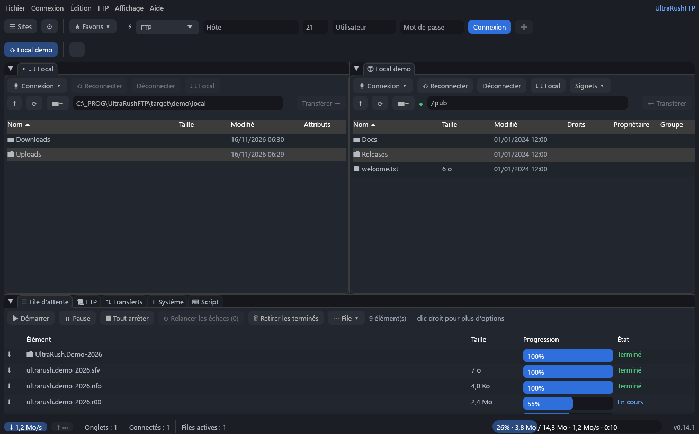
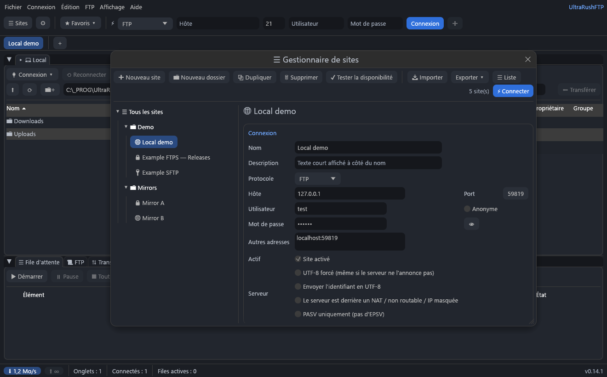
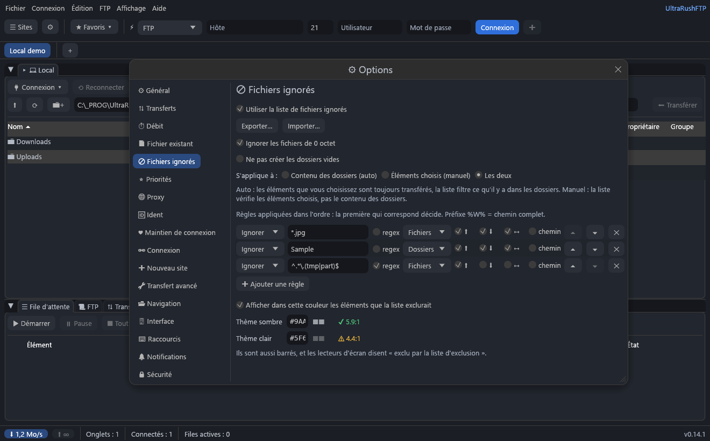

# UltraRushFTP

[English](README.md) | **Français**

Client FTP / FTPS / SFTP / FXP moderne pour Windows, écrit en Rust. Héritier spirituel
d'UltraFXP et de FTPRush v2 : onglets de sites, transferts en parallèle, FXP de site à
site, files d'attente avec liste d'exclusion et priorités, et pilotage depuis mIRC par une
DLL compatible avec la `rushmirc.dll` de FTPRush.



> **État — 0.14.1 (pré-version).** Le moteur (FTP, FTPS, SFTP, FXP, proxys, Ident, file
> d'attente), l'interface à onglets, le gestionnaire de sites, les options, les scripts
> Pascal, la liaison mIRC et la ligne de commande sont en place et couverts par des tests
> automatiques contre des serveurs de test locaux. Ils ont été vérifiés sur **glftpd** ;
> les autres serveurs (vsftpd, ProFTPD, FileZilla Server, IIS, OpenSSH) ne sont pas encore
> validés, voir [docs/VALIDATION.fr.md](docs/VALIDATION.fr.md). Voir
> [ROADMAP.fr.md](ROADMAP.fr.md) pour ce qui manque encore par rapport à FTPRush v2.

## Fonctionnalités

| Domaine | Ce qui est disponible |
|---|---|
| Protocoles | FTP, FTPS explicite (`AUTH TLS`, repli `AUTH SSL`), FTPS implicite, SFTP (mot de passe ou clé OpenSSH/PEM/PuTTY), FXP (en clair ou chiffré par `SSCN` / `CPSV`, inversion automatique des rôles) |
| Sécurité | TLS 1.2/1.3 avec rustls ; certificats vérifiés avec le magasin Windows, approuvés par empreinte SHA-256 ou (explicitement) acceptés ; clés d'hôte SSH approuvées par empreinte ; mots de passe enregistrés chiffrés par DPAPI de Windows |
| Réseau | Modes passif (`EPSV` → `PASV`, `PRET`) et actif (`PORT`/`EPRT`), proxys SOCKS4/4A/5 et HTTP avec règles de contournement, serveur Ident (RFC 1413, `URUSHFTP` par défaut), chemins locaux longs (> 260 caractères) et distants |
| Interface | Onglets (« containers » de FTPRush) avec un dock réorganisable : deux panneaux de fichiers, file d'attente, journal, console de script ; glisser-déposer ; raccourcis clavier ; thèmes sombre et clair ; anglais et français |
| File d'attente | Plusieurs transferts en parallèle d'un onglet vers un même site, limites par site, dossiers développés à leur tour, liste d'exclusion (joker / regex / chemin complet), priorités, règles « fichier existant », nouvelles tentatives, limitation de débit |
| Sites | Dossiers imbriqués, signets, réglages TLS / proxy / transferts par site ; import depuis FileZilla, FTPRush v1/v2/v3 et FlashFXP |
| Automatisation | Pascal Script de FTPRush (`RushApp.*`), DLL mIRC (`Invoke`, `RushScript`, `RushCommand`), options de démarrage de FTPRush v2, outil en ligne de commande `urftp` |

| Gestionnaire de sites | Options |
|---|---|
|  |  |

## Installation

Les [versions publiées](https://github.com/werewolf004/UltraRushFTP/releases) du dépôt
proposent deux paquets, chacun avec un fichier `.sha256` pour le vérifier :

- **Installateur** `UltraRushFTP-<version>-windows-x64-setup.exe` : installe pour
  l'utilisateur courant (sans droits d'administrateur) ou pour tous les utilisateurs, en
  anglais ou en français, avec un raccourci dans le menu Démarrer et un désinstallateur.
  Un UltraRushFTP lancé est d'abord fermé.
- **Zip portable** `UltraRushFTP-<version>-windows-x64.zip` : à décompresser où l'on veut.

Les deux contiennent `UltraRushFTP.exe` (interface), `urftp.exe` (ligne de commande),
`mirc/x86/rushmirc.dll` et `mirc/x64/rushmirc.dll`, la documentation, la licence et les
mentions des composants tiers. Réglages et sites sont enregistrés dans
`%APPDATA%\UltraRushFTP` (gardés à la désinstallation) ; lancer avec `-f` pour les garder
à côté du programme (mode portable).

Configuration requise : Windows 10 ou plus récent, 64 bits. Les versions ne sont pas
signées : Windows SmartScreen peut demander une confirmation au premier lancement
(*Informations complémentaires › Exécuter quand même*) ; le fichier `.sha256` publié avec
chaque version vérifie le téléchargement.

## Prise en main

- **Connexion rapide** : choisir le protocole, saisir hôte, port, utilisateur et mot de
  passe dans la barre du haut, puis **Connexion**. Le site s'ouvre dans le panneau droit de
  l'onglet courant.
- **Gestionnaire de sites** (`☰ Sites`) : créer des sites et des dossiers, ou importer ses
  carnets existants (*Importer*). Les mots de passe ne sont pas importés depuis les fichiers
  FTPRush v1/v2 et FlashFXP : il faut les ressaisir. Sélectionner un site puis
  **Connecter**.
- **Barre de connexion de chaque panneau** : `🔌 Connexion ▾` ouvre un site dans ce
  panneau ; `💻 Local` / `🌐 site` bascule le panneau entre son dossier local et sa
  connexion, qui reste ouverte.
- **Transférer** : sélectionner des fichiers puis `Espace`, les glisser sur l'autre panneau,
  ou passer par le clic droit. Les transferts passent par la file en bas de l'onglet.
- **Nouvel onglet** : `+` à côté des onglets ; chaque onglet a ses panneaux, sa file et son
  journal.

Toutes les options sont décrites dans [docs/OPTIONS.fr.md](docs/OPTIONS.fr.md).

## Piloter UltraRushFTP depuis mIRC

Copier `rushmirc.dll` (celle de `x86` pour le mIRC 32 bits habituel) à côté de ses scripts
mIRC, à la place de celle de FTPRush, et lancer UltraRushFTP. Les scripts existants
fonctionnent tels quels :

```text
//echo -a $dll(rushmirc.dll, Invoke, RushApp.TotalDownloadSize)
//dll rushmirc.dll RushScript RushApp.FTP.RAW('MonSite', 'SITE WHO', RS_LOGIN);
```

Les sites sont désignés par leur nom dans le gestionnaire. Les réponses des `RAW`
s'affichent dans mIRC (`/echo -a (site) …`) ; `/dll rushmirc.dll DisableCallback` les
coupe. Fermer FTPRush s'il est ouvert : la DLL parlerait à la première des deux
applications trouvée.

## Ligne de commande

Options de démarrage de l'interface (syntaxe de FTPRush v2), par exemple
`UltraRushFTP.exe -s"C:\jobs\nuit.pas" -rtx` exécute un script, transfère fenêtre réduite,
puis se ferme. L'outil `urftp` fonctionne sans fenêtre, avec les mêmes sites et options :

```text
urftp sites
urftp ls   MonSite:/pub
urftp get  MonSite:/pub/Release C:\Téléchargements
urftp put  C:\envoi\dossier MonSite:/incoming
urftp fxp  Site1:/pub/Release Site2:/incoming
urftp raw  MonSite "SITE WHO" STAT
```

Toutes leurs options sont listées dans
[docs/OPTIONS.fr.md](docs/OPTIONS.fr.md#ligne-de-commande).

## Documentation

| Document | Contenu |
|---|---|
| [docs/OPTIONS.fr.md](docs/OPTIONS.fr.md) | Toutes les options : interface, fiche de site, ligne de commande, `urftp`, variables d'environnement, fichiers |
| [docs/ARCHITECTURE.fr.md](docs/ARCHITECTURE.fr.md) | Crates, règles de conception, protocoles, protocole mIRC |
| [docs/DEPENDENCIES.fr.md](docs/DEPENDENCIES.fr.md) | Toutes les dépendances, leur licence et leur rôle |
| [ROADMAP.fr.md](ROADMAP.fr.md) | Fait, en cours, prévu |
| [docs/PARITY.fr.md](docs/PARITY.fr.md) | Chaque sujet de l'aide de FTPRush v2 et son état ici |
| [docs/VALIDATION.fr.md](docs/VALIDATION.fr.md) | Vérifier UltraRushFTP sur de vrais serveurs : script, liste de contrôle, résultats |
| [CHANGELOG.fr.md](CHANGELOG.fr.md) | Changements par version |
| [CONTRIBUTING.fr.md](CONTRIBUTING.fr.md) | Environnement de développement, règles, méthode de travail |
| [SECURITY.fr.md](SECURITY.fr.md) | Modèle de sécurité et signalement d'une vulnérabilité |

## Compiler depuis les sources

```text
cargo build --release -p urftp-gui -p urftp-cli -p rushmirc        # 64 bits
cargo build --release -p rushmirc --target i686-pc-windows-msvc    # DLL 32 bits pour mIRC
cargo test --workspace --all-features
```

La version du compilateur est fixée dans `rust-toolchain.toml` ; voir
[CONTRIBUTING.fr.md](CONTRIBUTING.fr.md) pour l'environnement de développement complet.

## Licence

Propriétaire — tous droits réservés. Voir [LICENSE](LICENSE) (traduction française :
[LICENSE.fr.md](LICENSE.fr.md)). Les composants tiers gardent leurs propres licences,
listées dans [docs/DEPENDENCIES.fr.md](docs/DEPENDENCIES.fr.md).
