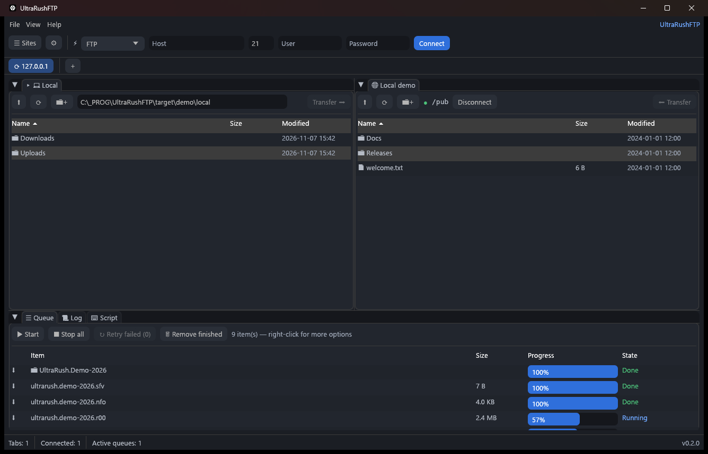
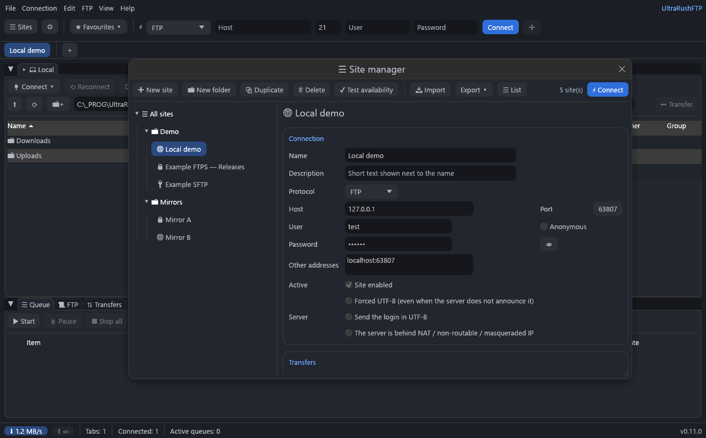
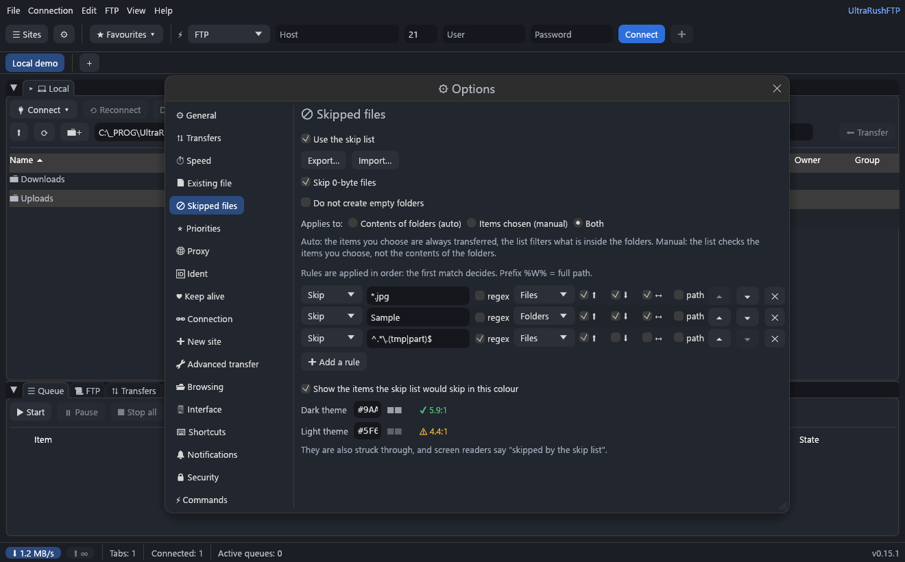

# UltraRushFTP

**English** | [Français](README.fr.md)

Modern FTP / FTPS / SFTP / FXP client for Windows, written in Rust. Spiritual heir of
UltraFXP and FTPRush v2: tabbed site containers, parallel transfers, site-to-site FXP,
queues with skip lists and priorities, and remote control from mIRC through a DLL
compatible with FTPRush's `rushmirc.dll`.



> **Status — 0.2.0 (pre-release).** The protocol engine (FTP, FTPS, SFTP, FXP, proxies,
> Ident, queue), the tabbed interface, the site manager, the options, Pascal scripting,
> the mIRC link and the command line are in place and covered by automated tests against
> local test servers. They have **not yet been validated against real-world servers**;
> see [ROADMAP.md](ROADMAP.md) for what is still missing compared with FTPRush v2.

## Features

| Area | What is available |
|---|---|
| Protocols | FTP, explicit FTPS (`AUTH TLS`, `AUTH SSL` fallback), implicit FTPS, SFTP (password or OpenSSH/PEM/PuTTY key), FXP (clear or encrypted with `SSCN` / `CPSV`, automatic role reversal) |
| Security | TLS 1.2/1.3 with rustls; certificates checked against the Windows store, trusted by SHA-256 fingerprint or (explicitly) accepted; SSH host keys trusted by fingerprint; passwords stored encrypted with Windows DPAPI |
| Network | Passive (`EPSV` → `PASV`, `PRET`) and active (`PORT`/`EPRT`) modes, SOCKS4/4A/5 and HTTP proxies with bypass rules, Ident server (RFC 1413, `URUSHFTP` by default), long local (> 260 characters) and remote paths |
| Interface | Tabs (FTPRush "containers") with a movable dock: two file panels, queue, log, script console; drag and drop; keyboard shortcuts; dark and light themes; English and French |
| Queue | Several transfers in parallel from one tab to one site, per-site limits, folders expanded in turn, skip list (wildcard / regex / full path), priorities, "existing file" rules, retries, speed limits |
| Sites | Nested folders, bookmarks, per-site TLS / proxy / transfer settings; import from FileZilla, FTPRush v1/v2/v3 and FlashFXP |
| Automation | FTPRush Pascal Script (`RushApp.*`), mIRC DLL (`Invoke`, `RushScript`, `RushCommand`), FTPRush v2 startup options, `urftp` command-line tool |

| Site manager | Options |
|---|---|
|  |  |

## Installation

1. Download `UltraRushFTP-<version>-windows-x64.zip` from the
   [releases](https://github.com/werewolf004/UltraRushFTP/releases) of the repository and
   check it against the published `.sha256` file.
2. Unzip it anywhere. It contains `UltraRushFTP.exe` (interface), `urftp.exe` (command
   line), `mirc/x86/rushmirc.dll` and `mirc/x64/rushmirc.dll`, the documentation, the
   licence and the third-party notices.
3. Run `UltraRushFTP.exe`. Settings and sites are stored in `%APPDATA%\UltraRushFTP`;
   start with `-f` to keep them next to the program instead (portable mode).

Requirements: Windows 10 or later, 64-bit. The binaries are not code-signed yet, so
Windows SmartScreen may ask for confirmation on first start.

## Quick start

- **Quick connect**: choose the protocol, type host, port, user and password in the top
  bar, then **Connect**. The site opens in the right panel of the current tab.
- **Site manager** (`☰ Sites`): create sites and folders, or import your existing site
  books (*Import*). Passwords are not imported from FTPRush v1/v2 and FlashFXP files:
  enter them again. Select a site and press **Connect**.
- **Transfer**: select files and press `Space`, drag them onto the other panel, or use
  the right-click menu. Transfers run in the queue at the bottom of the tab.
- **New tab**: `+` next to the tabs; each tab has its own panels, queue and log.

Every option is described in [docs/OPTIONS.md](docs/OPTIONS.md).

## Driving UltraRushFTP from mIRC

Copy `rushmirc.dll` (the `x86` one for the usual 32-bit mIRC) next to your mIRC scripts,
in place of FTPRush's one, and start UltraRushFTP. Existing scripts keep working:

```text
//echo -a $dll(rushmirc.dll, Invoke, RushApp.TotalDownloadSize)
//dll rushmirc.dll RushScript RushApp.FTP.RAW('MySite', 'SITE WHO', RS_LOGIN);
```

Sites are designated by their name in the site manager. `RAW` replies are echoed in mIRC
(`/echo -a (site) …`); `/dll rushmirc.dll DisableCallback` turns that off. Close FTPRush
if it is running: the DLL talks to the first of the two applications it finds.

## Command line

Startup options of the interface (FTPRush v2 syntax), e.g.
`UltraRushFTP.exe -s"C:\jobs\night.pas" -rtx` runs a script, transfers minimised, then
quits. The `urftp` tool works without a window, with the same sites and options:

```text
urftp sites
urftp ls   MySite:/pub
urftp get  MySite:/pub/Release C:\Downloads
urftp put  C:\outgoing\folder MySite:/incoming
urftp fxp  Site1:/pub/Release Site2:/incoming
urftp raw  MySite "SITE WHO" STAT
```

All options of both are listed in [docs/OPTIONS.md](docs/OPTIONS.md#command-line).

## Documentation

| Document | Content |
|---|---|
| [docs/OPTIONS.md](docs/OPTIONS.md) | Every option: interface, site record, command line, `urftp`, environment variables, files |
| [docs/ARCHITECTURE.md](docs/ARCHITECTURE.md) | Crates, design rules, protocols, mIRC protocol |
| [docs/DEPENDENCIES.md](docs/DEPENDENCIES.md) | Every dependency, its licence and why it is used |
| [ROADMAP.md](ROADMAP.md) | Done, in progress, planned |
| [docs/PARITY.md](docs/PARITY.md) | Every topic of the FTPRush v2 help and its status here |
| [CHANGELOG.md](CHANGELOG.md) | Changes per version |
| [CONTRIBUTING.md](CONTRIBUTING.md) | Development set-up, rules, workflow |
| [SECURITY.md](SECURITY.md) | Security model and how to report a vulnerability |

## Building from source

```text
cargo build --release -p urftp-gui -p urftp-cli -p rushmirc        # 64-bit
cargo build --release -p rushmirc --target i686-pc-windows-msvc    # 32-bit DLL for mIRC
cargo test --workspace --all-features
```

The toolchain version is pinned in `rust-toolchain.toml`; see
[CONTRIBUTING.md](CONTRIBUTING.md) for the full development set-up.

## Licence

Proprietary — all rights reserved. See [LICENSE](LICENSE) (French translation:
[LICENSE.fr.md](LICENSE.fr.md)). Third-party components keep their own licences, listed
in [docs/DEPENDENCIES.md](docs/DEPENDENCIES.md).
