# Référence des options

[English](OPTIONS.md) | **Français**

Tous les réglages d'UltraRushFTP, avec leur valeur par défaut. Sommaire :
[interface](#interface) · [fenêtre Options](#fenêtre-options) ·
[fiche de site](#fiche-de-site) · [ligne de commande](#ligne-de-commande) ·
[outil `urftp`](#outil-urftp) · [scripts](#scripts-rushapp) · [DLL mIRC](#dll-mirc) ·
[variables d'environnement](#variables-denvironnement) · [fichiers](#fichiers)

## Interface

### Menus et barre du haut

| Élément | Effet |
|---|---|
| Fichier → Gestionnaire de sites | Ouvre le gestionnaire de sites |
| Fichier → Nouvel onglet | Nouvel onglet vide (aussi `+` à côté des onglets) |
| Fichier → Nouvel onglet à partir de l'actuel | Nouvel onglet avec la disposition, les dossiers locaux et les connexions (mêmes sites, mêmes dossiers) de l'onglet affiché, sans sa file (`Ctrl+Maj+T`, ou clic droit sur un onglet) |
| Fichier → Options… | Ouvre la fenêtre Options (aussi `⚙`) |
| Fichier → Téléchargement manuel… | Voir *Téléchargement manuel* |
| Fichier → Sauvegarder la configuration / Restaurer une sauvegarde | Voir *Sauvegardes* |
| Fichier → Verrouiller | Verrouille la fenêtre jusqu'au mot de passe maître (Options › Sécurité) |
| Fichier → Quitter | Quitte |
| Connexion → *site* | Connecte le panneau actif (marqué `▸`) à un site du gestionnaire ; les dossiers sont des sous-menus ; `Maj` : connexion fantôme, `Ctrl` : `-password` |
| Connexion → Gestionnaire de sites | Ouvre le gestionnaire de sites |
| Connexion → Reconnecter / Déconnecter | Agit sur la connexion du panneau actif |
| Connexion → Local / *site* | Bascule le panneau actif entre son dossier local et sa connexion |
| Édition → Filtre rapide, Tout sélectionner, Sélectionner / Désélectionner par masque, Copier les noms, Marques, Renommer plusieurs, Déplacer vers, Coller des fichiers | Agissent sur le panneau actif (voir *Panneaux de fichiers*) |
| FTP → Droits, Modifier la date, Voir le listing brut | Agissent sur le panneau distant actif |
| FTP → Espace utilisé, Exporter l'arborescence, Chercher sur les sites, Comparer les panneaux | Voir *Outils de dossier* |
| FTP → Vider le cache de ce site / tous les caches, Fichiers en cours de modification | Voir *Outils de dossier* |
| FTP → Envoyer une commande RAW (`Ctrl+R`), Commandes de site | Voir *Commandes RAW* |
| FTP → Traduction d'adresse IP… | Une adresse écrite en hexadécimal (`C0A80101`, `0xC0A80101`) ou en un seul nombre (`3232235777`) sous forme pointée, avec un bouton Copier |
| FTP → Relancer le service UPnP | Recherche à nouveau le routeur (Options › Connexion) |
| Affichage → Liste des fenêtres / Fenêtre des tâches | Affiche ou masque ce volet dans l'onglet affiché (à côté de la file) ; voir *Liste des fenêtres et fenêtre des tâches* |
| Affichage → Colonnes de la liste des fenêtres | Colonnes FTP et Action de la liste des fenêtres |
| Affichage → Dispositions | Appliquer, enregistrer ou supprimer une disposition des panneaux ; revenir à celle par défaut ; *Panneaux en onglets* : les deux panneaux de fichiers dans une seule zone, leurs titres basculent de l'un à l'autre |
| Affichage → Thème clair / Thème sombre | Change le thème (enregistré aussi dans les options) |
| Aide → Aide (F1) | Cette documentation, intégrée : index des sections, recherche, raccourcis clavier |
| Aide → Raccourcis clavier | L'aide sur les raccourcis ci-dessous |
| Aide → À propos d'UltraRushFTP | Version, compilation et licence |
| `★ Favoris ▾` | Sites récents (10), connexions rapides (10, sans leur mot de passe : une anonyme se connecte aussitôt, sinon le champ mot de passe attend), tous les sites du gestionnaire, *Téléchargement manuel* : connecte le panneau actif. Scindé (options) : `★ <dernier site>` s'y connecte, `⏷` ouvre le menu |
| `➕` après Connexion | Enregistre la connexion rapide comme site du gestionnaire (avec son mot de passe) |
| Connexion rapide | Protocole (FTP, FTPS explicite, FTPS implicite, SFTP), hôte, port, utilisateur, mot de passe, **Connexion** : ouvre le site dans le panneau droit de l'onglet courant (ou dans un nouvel onglet, voir *Général*) |
| Onglets | Un onglet par conteneur de sites ; `✕` le ferme, le titre est l'hôte ou « Onglet n » ; `Ctrl+T` nouveau, `Ctrl+Maj+T` à partir de l'actuel, `Ctrl+W` fermer, `Ctrl+Tab` / `Ctrl+Maj+Tab` suivant / précédent |

### Panneaux de fichiers

Chaque panneau a sa propre barre de connexion, au-dessus de son dossier :

| Bouton | Effet |
|---|---|
| `🔌 Connexion ▾` | Menu des sites du gestionnaire (les dossiers en sous-menus) et *Gestionnaire de sites* : connecte **ce** panneau ; `Maj` : connexion fantôme, `Ctrl` : `-password`. Le dossier local du site, s'il est rempli, va dans l'autre panneau quand celui-ci est local. |
| `⟲ Reconnecter` | Rouvre la connexion du panneau, dans le même dossier |
| `Déconnecter` | Ferme la connexion du panneau (affichée, ou gardée derrière le dossier local) |
| `Signets ▾` | Signets de la fiche du site (panneau distant) : va dans le dossier distant ; `Maj` : le dossier local du signet dans l'autre panneau aussi. Les jetons de date prennent la date du jour : `%yyyy%` / `%yy%` année, `%mm%` / `%m%` mois, `%dd%` / `%d%` jour, `%ww%` / `%w%` semaine ISO |
| `💻 Local` / `🌐 site` | Bascule le panneau entre son dossier local et sa connexion ; la connexion reste ouverte pendant ce temps, et l'onglet garde son nom |

Dans un panneau distant, le champ du chemin accepte un dossier (absolu, ou relatif au
dossier courant) : `Entrée` y va.

| Action | Souris | Clavier |
|---|---|---|
| Ouvrir un dossier | double-clic | `Entrée` |
| Dossier parent | `⬆` | `Retour arrière` |
| Actualiser | `⟳` | `F5` |
| Nouveau dossier | `📁+` | `F7` |
| Renommer | clic droit → Renommer | `F2` |
| Supprimer (avec confirmation) | clic droit → Supprimer | `Suppr` |
| Transférer vers l'autre panneau | bouton `Transférer`, glisser-déposer, clic droit | `Espace` ou `Inser` |
| Changer de panneau | clic | `F6` |
| Déplacer le curseur | — | flèches, `Page préc.` / `Page suiv.`, `Début` / `Fin` |
| Tout sélectionner / plusieurs | `Ctrl`+clic, `Maj`+clic, clic droit › *Tout sélectionner* | `Ctrl+A`, `Maj`+déplacement, `Ctrl+Espace` (ligne du curseur) |
| Copier le chemin complet | clic droit → Copier le chemin | — |
| Copier l'adresse web | clic droit → Copier l'adresse HTTP (panneau distant d'un site qui a une adresse web) | — |
| Transfert conditionnel | clic droit → Transfert conditionnel… (voir plus bas) | — |
| Fichier SFV ou MD5 des fichiers sélectionnés | clic droit → Créer un fichier SFV / Créer un fichier MD5 (panneau local) | — |
| Trier | clic sur un en-tête de colonne (à nouveau : ordre inverse) | — |
| Filtre rapide : seulement les noms qui ont tous les mots, `-mot` exclut, `*.masque`, `"-mot"` tel quel, ou une expression régulière | Édition → Filtre rapide | `Ctrl+F` ; `Échap` le ferme, `F5` réaffiche tout |
| Marquer / démarquer (gras souligné) | clic droit → Marquer / démarquer ; Édition → Marques (tout démarquer, sélectionner les marqués, copier leurs chemins) | `Ctrl+M` |
| Sélectionner / désélectionner par masque (`*.rar;*.r??`) | menu Édition | `+` / `-` |
| Copier les noms de la sélection, un par ligne | clic droit → Copier les noms | `Ctrl+Maj+C` |
| Renommer plusieurs éléments : modèle `%f` (nom), `%n` (sans extension), `%e` (extension), `%c` (compteur, départ, pas, chiffres), remplacement (texte ou expression régulière, groupes `$1`/`${1}`), casse, aperçu | clic droit → Renommer plusieurs… | — |
| Déplacer vers un dossier (relatif ou absolu ; le dossier de l'autre panneau est proposé quand il montre le même site) | clic droit → Déplacer vers… | — |
| Droits (CHMOD) : cases ou valeur octale, contenu des dossiers aussi | clic droit → Droits (distant) | — |
| Modifier la date (UTC ; `MFMT`, sinon `SITE UTIME` ; `SETSTAT` en SFTP) | clic droit → Modifier la date (distant) | — |
| Voir / modifier un fichier distant avec son programme (voir *Navigation*) | double-clic sur un fichier distant (voir) ; clic droit → Voir / Modifier | `F3` / `F4` |
| Ouvrir un dossier dans les deux panneaux | `Maj`+double-clic | — |
| Envoyer des fichiers de l'Explorateur dans le panneau distant | les glisser sur le panneau | `Ctrl+V` après les avoir copiés dans l'Explorateur |

Les touches de la liste agissent sur le panneau actif (marqué `▸`, curseur encadré) quand
aucun contrôle n'a le focus clavier. `Tab` / `Maj+Tab` passent d'un contrôle à l'autre et
`Échap` rend les touches à la liste.

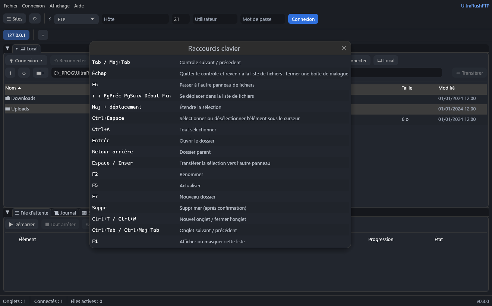

Les panneaux distants montrent les colonnes droits, propriétaire et groupe ; les panneaux
locaux les attributs Windows (`R` lecture seule, `H` caché, `S` système, `A` archive).

Les fichiers SFV et MD5 portent le nom du dossier (`dossier.sfv`, `dossier.md5`) et y
sont écrits, en arrière-plan ; le journal indique quand ils sont prêts.

### Outils de dossier

| Outil | Effet |
|---|---|
| Comparer les panneaux | Options cochées dans le sous-menu : *même nom* ou *même nom et même taille* (dossiers : nom seulement), *ignorer les extensions*, *masquer ce qui est identique*, *sélectionner ce qui diffère* ; puis *Comparer maintenant*. `F5` réaffiche tout |
| Espace utilisé | Fichiers, dossiers et taille d'un dossier (distant ou local), et de chaque dossier qu'il contient ; *Profondeur* 0 = tous les niveaux, 1 = seulement les dossiers qu'il contient… |
| Exporter l'arborescence | L'arborescence en texte (retrait, tailles, dossiers seulement), à copier ou enregistrer |
| Chercher sur les sites | Mots séparés par `;` (un mot avec `*` ou `?` est un masque du nom entier, les autres sont cherchés dans les noms), mots à exclure, dossier, profondeur, type, dates (`AAAA-MM-JJ`), tailles (Kio) ; les sites cochés sont parcourus l'un après l'autre, chacun avec sa propre connexion. Clic droit sur les résultats : les ajouter (ou leur dossier) à la file, vers le panneau local de l'onglet, ou copier leur adresse `ftp://` |
| Voir le listing brut | Le listing du dossier tel que le serveur l'a envoyé (FTP), ou en lignes `ls -l` (SFTP) |
| Vider le cache | Oublie les dossiers gardés par le cache des dossiers (voir *Navigation*) |
| Fichiers en cours de modification | Fichiers distants ouverts avec un programme : état, *Renvoyer maintenant*, *Ne plus surveiller* |

Les parcours et les recherches ont leur propre connexion : le panneau reste libre pendant ce
temps.

### Journaux et barre d'état

Chaque onglet a trois journaux : **FTP** (commandes, réponses, connexions des panneaux),
**Transferts** (file, éléments, contrôles CRC) et **Système** (fichiers écrits,
opérations locales, scripts, notifications). Les lignes montrent leur heure et le site
(ou Gauche / Droite), voir *Interface*. Avec *Écrire aussi les journaux dans des
fichiers*, chaque journal va dans `<dossier>\<date>-ftp.log`, `-transfer.log`,
`-system.log`.

Pendant une file, la barre d'état montre sa barre de progression avec le texte de
l'option *Interface* (`%p` pourcentage, `%b` octets, `%s` vitesse, `%e` temps restant,
`%c` éléments).

Les boutons **⬇** et **⬆** à gauche de la barre d'état montrent les limites de réception
et d'envoi d'Options › Débit et activent ou désactivent chacune en un clic (`∞` : illimité),
tout de suite, transferts en cours compris. Ils sont grisés tant qu'aucune limite n'est
réglée.

### Commandes RAW

**FTP → Envoyer une commande RAW** (`Ctrl+R`) : plusieurs commandes, une par ligne,
envoyées au panneau actif, aux deux panneaux ou à tous les sites connectés ;
`Ctrl+Entrée` envoie. Les réponses sont listées sous les commandes et dans le journal FTP.

**FTP → Commandes de site** : les commandes d'*Options › Interface* (`SITE WHO`,
`SITE NEW`…). Une commande avec `%1` s'ouvre dans la boîte RAW pour être complétée.

### Téléchargement manuel

**Fichier → Téléchargement manuel** (aussi dans les favoris) : des adresses, une par
ligne — `ftp://utilisateur:motdepasse@hôte:port/chemin`, `ftps://` (explicite),
`ftpsi://` (implicite), `sftp://` ; un chemin terminé par `/` est un dossier. `[1-12]` ou
`[01-12]` fait une liste (`fichier[01-12].rar`). Les éléments vont dans la file de
l'onglet, vers le dossier choisi. Avec la surveillance du presse-papiers (*Interface*),
les adresses copiées n'importe où ouvrent cette fenêtre, ou sont mises en file aussitôt.

### Transfert conditionnel

Clic droit → *Transfert conditionnel…* met la sélection en file vers l'autre panneau, avec
des conditions :

| Champ | Effet |
|---|---|
| Noms de dossiers / Noms de fichiers, Inclure et Exclure | Masques séparés par `;` (jokers, ou expressions régulières avec *Utiliser des expressions régulières*) ; `%F%` devant un masque le réserve aux fichiers, `%D%` aux dossiers |
| Date entre | Premier et dernier jour (`AAAA-MM-JJ`, dernier jour inclus) |
| Pas plus ancien que | Nombre de jours |
| Taille de fichier entre | En Kio (maximum 0 : sans limite) |
| Appliquer les dates aux dossiers aussi | Sinon les dates ne filtrent que les fichiers |
| Ne pas utiliser la liste de fichiers ignorés | La liste des options est ignorée |
| Inclure les sous-dossiers | Sinon seulement les fichiers des dossiers sélectionnés |
| Se déconnecter une fois transféré | Les panneaux de l'onglet sont déconnectés quand la file est terminée |
| Synchroniser | Seul ce qui diffère est transféré : un fichier absent, une taille différente (*Comparer les tailles*), une source plus récente (*Comparer les dates*, de plus d'une minute) ; *Supprimer ce que la source n'a pas* retire de la cible ce qui manque à la source ; *Fichiers existants seulement* met à jour les fichiers que la cible a déjà ; *Dans les deux sens* recopie ce que seule la cible possède |

Les conditions s'appliquent aux éléments sélectionnés et au contenu des dossiers. *Schéma*
enregistre le formulaire sous un nom (*Enregistrer*, *Supprimer*) dans `settings.json`.
**Démarrer le transfert** met en file et démarre, **Ajouter à la file** met seulement en
file.

### Accessibilité

- Chaque contrôle a un nom pour les lecteurs d'écran (AccessKit), y compris les boutons à
  symbole et les champs qui n'affichent qu'un texte indicatif ; les lignes de fichiers sont
  lues « nom, taille, date ».
- Les deux thèmes respectent le contraste WCAG 2.2 AA (4,5:1 pour le texte, 3:1 pour le
  focus et les indicateurs d'état) et les cibles font au moins 24 px ou sont espacées comme
  le permet le critère WCAG 2.5.8 ; des tests vérifient les deux.
- Un état n'est jamais indiqué par la couleur seule (symboles, `⚠`, avertissements écrits).
- Les confirmations d'actions irréversibles démarrent sur **Annuler**.

### File d'attente

Boutons : **Démarrer** (**Reprendre** après une pause), **Pause**, **Tout arrêter**,
**Relancer les échecs**, **Retirer les terminés**, et le menu **⋯ File** : *Informations
sur la file…*, *Tout marquer en échec*, *Retirer les échecs*, *Vider la file (sauf en
cours)*, *Charger un fichier de file…*, *Enregistrer la file dans un fichier…*, *Planifier
la file en tâche…* (voir *Liste des fenêtres et fenêtre des tâches*).

- **Pause** interrompt les transferts en cours : ils attendent à nouveau et reprennent
  depuis leur fichier partiel avec *Reprendre*. **Tout arrêter** arrête les éléments en
  cours et termine la file ; les autres restent en attente.
- **Lignes** : un clic sélectionne, `Ctrl`+clic ajoute ou retire une ligne, `Maj`+clic
  sélectionne une plage. Le menu du clic droit agit sur la sélection quand la ligne en fait
  partie : arrêter, relancer, *Modifier…* (un élément : site et chemin de la source et de la
  cible, mode de transfert, *Inverser le FXP*), *Inverser le FXP* (éléments de site à site),
  *Marquer en échec*, tout en haut / monter / descendre / tout en bas, retirer.
- **Informations sur la file** : éléments, téléchargements / envois / FXP, nombre par
  état, tailles totale, transférée et restante, temps restant à la vitesse actuelle.
- **Fichiers de file** (`.urq`) : les éléments non terminés de l'onglet, au format de
  `queue.json` ; le chargement ajoute les éléments du fichier (ou d'un `queue.json`) à la
  file de l'onglet.

États : en attente, en cours, terminé, ignoré (avec la raison), à confirmer, arrêté, échec.

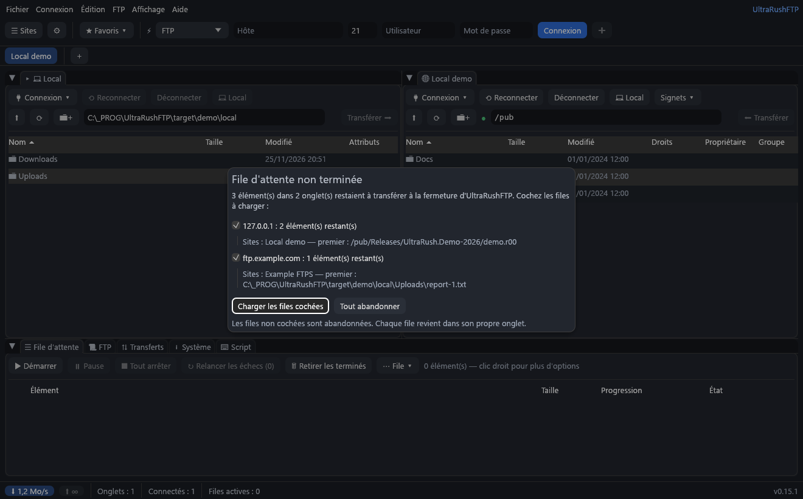

Les éléments restant à faire sont enregistrés dans `queue.json` (toutes les deux secondes
quand la file change, et à la fermeture de l'application), onglet par onglet. Au démarrage
suivant, ils sont proposés à nouveau (voir *File non terminée au démarrage*) : une ligne
par onglet, avec son titre, le nombre d'éléments restants, les sites et le premier élément ;
décochez les files dont vous ne voulez pas, les autres reviennent chacune dans son propre
onglet. Les éléments en cours, arrêtés
ou à confirmer reviennent en attente, ceux en échec restent en échec, les terminés et
ignorés disparaissent. **Démarrer** reprend la file ; un fichier partiel est repris selon les
règles *Fichier existant*. Les éléments doivent utiliser des sites du gestionnaire de
sites : une connexion rapide n'est pas gardée.

### Liste des fenêtres et fenêtre des tâches

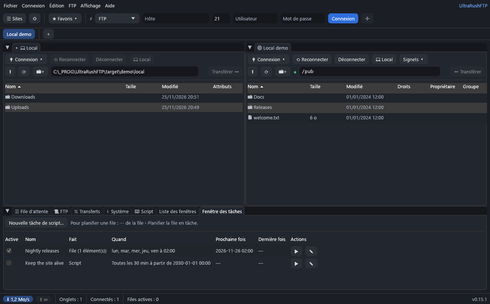

Deux volets ajoutés par le menu **Affichage**, dans l'onglet affiché (ils se déplacent comme
les autres volets et sont gardés par les dispositions enregistrées).

**Liste des fenêtres** : une ligne par onglet : son numéro et son titre, ce que montre
chaque panneau (dossier local, ou `site:dossier`), et les colonnes facultatives **FTP**
(connexions de l'onglet : *2 connecté(s)*, *1 sur 2 connecté(s)*) et **Action**
(*Transfert (3 en cours, 12 en attente)*, *En pause*, *5 en attente*, *Inactif*), choisies
dans Affichage → Colonnes de la liste des fenêtres. Un clic sur une ligne affiche cet
onglet ; `✕` le ferme (avec la confirmation d'un onglet occupé).

**Fenêtre des tâches** : les tâches planifiées, avec leur état (active ou non), ce qu'elles
font, quand, la prochaine et la dernière fois. `▶` lance une tâche tout de suite, `✎` ouvre
sa boîte de dialogue.

| Réglage d'une tâche | Valeurs |
|---|---|
| Nom, Active | Texte libre ; une tâche inactive garde ses réglages et ne se lance jamais |
| Quand | **Une fois** à une date et une heure (`AAAA-MM-JJ HH:MM`) ; **Toutes les N minutes** (1 à 10 080) à partir d'une première fois ; **Jours de la semaine** à une heure (`HH:MM`), les jours cochés |
| Tâche de file | Créée par ⋯ File › *Planifier la file en tâche…* avec les éléments non terminés de l'onglet ; à son heure, la file s'ouvre dans un **nouvel onglet** et démarre (l'onglet affiché ne change pas) ; *Fermer l'onglet une fois la file terminée* |
| Tâche de script | **Nouvelle tâche de script…** : Pascal Script lancé comme la console (`ShellExecuteCommand` suit Options › Sécurité) |

Les heures sont celles de l'horloge de l'ordinateur. Une heure passée pendant
qu'UltraRushFTP est fermé **n'est pas rattrapée** : la tâche affiche *Manquée* et attend sa
prochaine fois (une tâche unique se désactive). Les tâches sont enregistrées dans
`tasks.json`.

## Fenêtre Options

Enregistrée automatiquement dans `settings.json` une seconde après une modification.

### Général

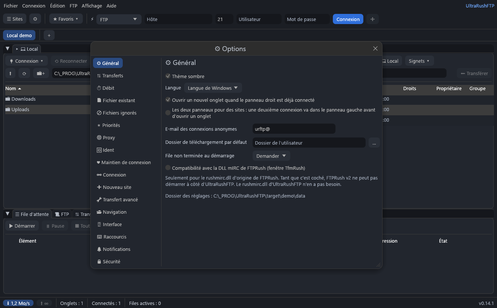

| Option | Défaut | Effet |
|---|---|---|
| Thème sombre | oui | Thème sombre ou clair |
| Langue | Langue de Windows | Langue de Windows, English ou Français ; appliquée tout de suite |
| Ouvrir un nouvel onglet quand le panneau droit est déjà connecté | oui | Sinon la nouvelle connexion remplace la connexion en cours |
| Les deux panneaux pour des sites | non | Une deuxième connexion va dans le panneau gauche (s'il montre un dossier local) avant d'ouvrir un onglet : deux sites face à face pour le FXP |
| E-mail des connexions anonymes | `urftp@` | Mot de passe envoyé par les sites réglés en *anonyme* |
| Dossier de téléchargement par défaut | dossier de l'utilisateur | Dossier où démarrent les panneaux locaux, et où ils reviennent à la déconnexion ; le dossier de l'utilisateur quand il n'existe pas |
| File non terminée au démarrage | Demander | Demander, La charger ou L'abandonner (voir *File d'attente*) |
| Compatibilité avec la DLL mIRC de FTPRush (fenêtre TfmRush) | non | Voir *DLL mIRC* ; tant que c'est coché, FTPRush v2 ne peut pas démarrer à côté d'UltraRushFTP |

### Transferts


| Option | Défaut | Effet |
|---|---|---|
| Nouvelles tentatives après un échec | 3 | Essais après le premier échec d'un élément |
| Délai entre deux tentatives (s) | 3 | Attente avant un nouvel essai |
| Transferts simultanés au total | 0 (sans limite) | Limite tous sites confondus, en plus des limites par site |
| Transferts simultanés en connexion rapide | 2 | Limite par site utilisée par la connexion rapide |
| Délai de connexion (s) | 30 | Connexions de contrôle et de données |
| Délai sans réponse du serveur (s) | 120 | Attente maximale d'une réponse ou d'un bloc de données |
| Arrêter et reprendre sans données pendant | 0 s (le délai ci-dessus) | Un transfert qui ne reçoit ni n'envoie rien pendant ce temps est arrêté puis repris par les tentatives (FTP et SFTP) |
| Téléchargements / Envois / FXP : nombre de tentatives propre | désactivé | Tentatives de ce sens au lieu de la valeur générale (un réglage du site l'emporte toujours) |
| Relancer les échecs à la fin de la file (tours) | 0 | Une fois la file terminée, les éléments en échec sont retentés ce nombre de fois |
| Relance cyclique | désactivé | Un élément à relancer passe en bas de la file, les autres passent avant, sans délai |
| Relancer les échecs quand une file démarre automatiquement | désactivé | `-r` au démarrage |
| Déconnecter un site retire ses éléments en attente | désactivé | *Déconnecter* d'un panneau |
| Source et cible de chaque élément dans le journal | désactivé | Une ligne quand un élément démarre, se termine ou est mis en pause |
| Quand toutes les files sont terminées | Ne rien faire | Ne rien faire, Déconnecter les sites, Quitter UltraRushFTP, Veille, Veille prolongée, Éteindre l'ordinateur |
| Secondes pour annuler | 30 | Quitter, la veille, la veille prolongée et l'arrêt sont demandés d'abord avec ce compte à rebours (*Annuler*, *Le faire maintenant*) |

### Débit

| Option | Défaut | Effet |
|---|---|---|
| Téléchargement (Kio/s) | 0 (illimité) | Partagé par tous les téléchargements, appliqué tout de suite |
| Envoi (Kio/s) | 0 (illimité) | Partagé par tous les envois, appliqué tout de suite |
| Appliquer la limite de réception / la limite d'envoi | oui | Aussi les boutons ⬇ / ⬆ de la barre d'état : une limite désactivée garde sa valeur |

Le FXP n'est pas limité : ses données ne passent pas par cet ordinateur.

### Fichier existant


Trois jeux de règles : **Envoi**, **Réception** et **FXP (FTP à FTP)**.

| Cas | Défaut | Choix |
|---|---|---|
| La cible est plus petite | Reprendre | Reprendre, Ignorer, Renommer (« nom (1) »), Écraser, Demander |
| La cible a la même taille | Ignorer | idem |
| La cible est plus grande | Renommer | idem |
| Recommencer depuis le début si la reprise est refusée | oui | Écrase quand le serveur refuse `REST` (tous les sens) |

Les règles d'une version précédente s'appliquent aux trois sens.

### Fichiers ignorés

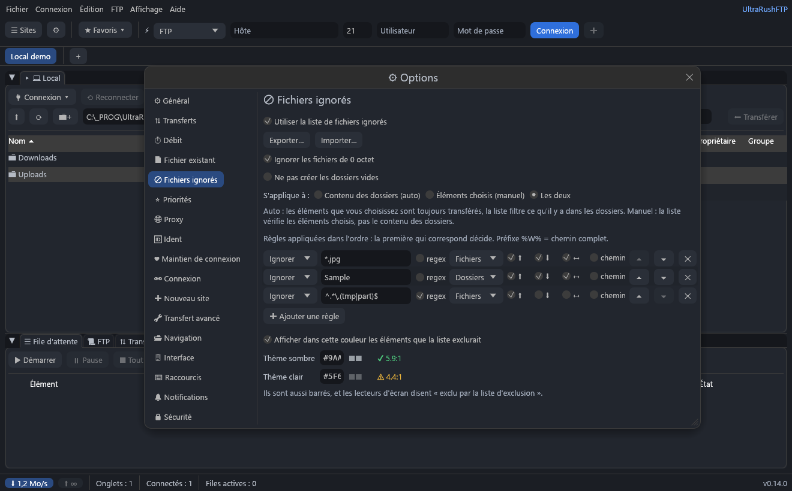

| Option | Défaut | Effet |
|---|---|---|
| Utiliser la liste de fichiers ignorés | oui | Active les règles ci-dessous |
| Ignorer les fichiers de 0 octet | non | — |
| Ne pas créer les dossiers vides | non | — |
| S'applique à | Les deux | **Contenu des dossiers (auto)** : les éléments que vous choisissez sont toujours transférés, les règles filtrent ce qui est trouvé dans les dossiers ; **Éléments choisis (manuel)** : les règles vérifient les éléments choisis, pas le contenu des dossiers ; **Les deux** |
| Afficher dans cette couleur les éléments que la liste exclurait | oui, `#9AA0A6` (sombre) / `#5F6368` (clair) | Dans les panneaux, aussi barrés et annoncés par les lecteurs d'écran (« exclu par la liste d'exclusion ») ; le contraste est affiché |
| Règles | aucune | Appliquées dans l'ordre, la première qui correspond décide : **Ignorer** ou **Autoriser**, masque (joker `*` `?`, ou expression régulière avec *regex*), cible (fichiers, dossiers, les deux), sens (envoi ⬆, téléchargement ⬇, FXP ↔), *chemin* = le masque porte sur le chemin complet (s'écrit aussi `%W%masque`) |
| Exporter… / Importer… | — | Les règles dans un fichier JSON ; *Importer* lit aussi un fichier texte d'un masque par ligne (lignes commençant par `#` ignorées) et ajoute les règles |

### Priorités

Liste ordonnée de masques (`*.sfv`, `*.nfo` par défaut) : les éléments correspondants
passent en tête de file, le premier masque étant le plus prioritaire.

### Proxy


Utilisé par les sites réglés sur *Réglage global*.

| Option | Défaut | Effet |
|---|---|---|
| Utiliser un proxy… | non | Active le proxy global |
| Type | SOCKS5 | SOCKS4, SOCKS4A, SOCKS5, tunnel HTTP |
| Hôte et port | — / 1080 | Adresse du proxy |
| Utilisateur, mot de passe | vides | Authentification (SOCKS5, HTTP Basic) ; mot de passe chiffré par DPAPI |
| Exceptions | vide | Masques d'hôtes joints directement, séparés par `;` (`220.67.*;*.lan`) |
| Faire passer aussi les transferts par le proxy | oui | Canaux de données aussi |
| Pas de proxy pour le réseau local | oui | `localhost`, adresses privées, noms sans point |

**Proxys nommés** : *+ Ajouter un proxy* crée un proxy avec un nom et les mêmes champs
(type, hôte, port, identifiants, canaux de données). Une fiche de site le choisit par son
nom dans sa liste *Proxy* ; un site dont le proxy a été retiré de la liste suit le réglage
global. À travers un proxy, les canaux de données utilisent toujours le mode passif.

### Ident


| Option | Défaut | Effet |
|---|---|---|
| Activer le serveur Ident | non | Serveur RFC 1413 interrogé par beaucoup de serveurs FTP à la connexion |
| Nom répondu | `URUSHFTP` | Nom d'utilisateur renvoyé |
| Système | `UNIX` | Système renvoyé |
| Port TCP | 113 | À rediriger depuis le routeur vers cet ordinateur derrière un NAT |
| Répondre seulement pendant l'ouverture d'une connexion | non | Les requêtes des connexions en cours d'ouverture reçoivent leur nom ; toute autre requête reçoit `ERROR : NO-USER` |

### Maintien de connexion

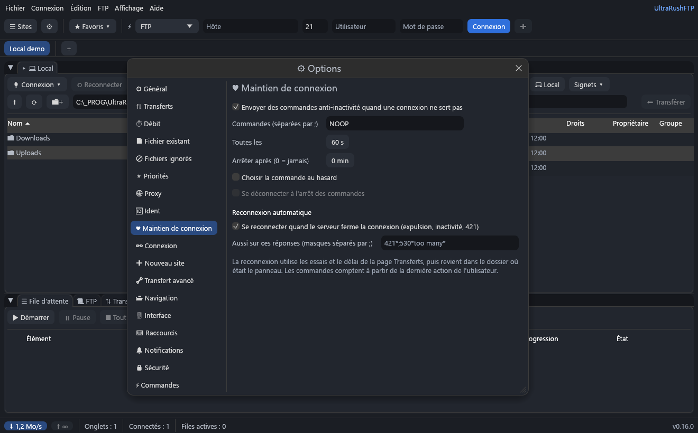

| Option | Défaut | Effet |
|---|---|---|
| Envoyer des commandes anti-inactivité | oui | Évite que le serveur expulse les connexions inactives |
| Commandes | `NOOP` | Envoyées à tour de rôle, séparées par `;` (par exemple `NOOP;PWD`) |
| Toutes les | 60 s | Inactivité avant une commande, puis entre deux commandes (5 s minimum) |
| Arrêter après | 0 (jamais) | Minutes sans action de l'utilisateur après lesquelles les commandes s'arrêtent |
| Choisir la commande au hasard | non | Certains serveurs repèrent une commande envoyée encore et encore |
| Se déconnecter à l'arrêt des commandes | non | Se déconnecte quand la limite ci-dessus est atteinte |
| Se reconnecter quand le serveur ferme la connexion | oui | Expulsion, inactivité, `421` : se reconnecte et revient dans le dossier du panneau |
| Aussi sur ces réponses | — | Masques à jokers sur la réponse du serveur, séparés par `;` (par exemple `530*too many*`) |

La reconnexion fait autant d'essais que *Nombre d'essais* de la page Transferts, en
attendant *Délai entre deux essais* avant chacun. Le moteur de file vérifie aussi une
connexion restée inactive avant de la réutiliser, et en ouvre une nouvelle quand le
serveur l'a coupée.

### Connexion

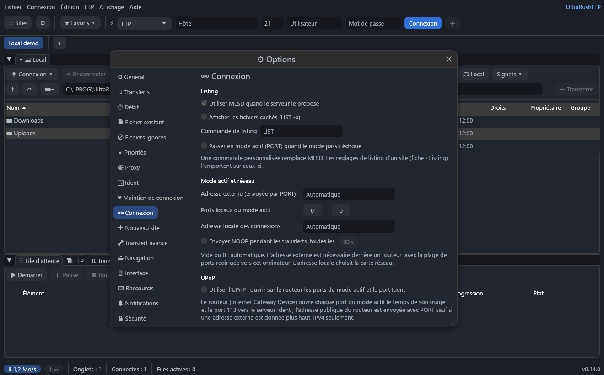

| Option | Défaut | Effet |
|---|---|---|
| Utiliser MLSD quand le serveur le propose | oui | `MLSD` donne des dates et tailles exactes ; désactivé : la commande de listing ci-dessous |
| Afficher les fichiers cachés (LIST -a) | non | `LIST -a` au lieu de `LIST` (fichiers commençant par `.` ; nécessaire pour supprimer un dossier qui en contient) |
| Commande de listing | vide (`LIST`) | N'importe quelle commande (`LIST -al`...) ; une commande commençant par `STAT` est lue sur le canal de contrôle. Remplace `MLSD` |
| Passer en mode actif (PORT) quand le mode passif échoue | non | `PASV`/`EPSV` refusé ou connexion de données impossible : la connexion continue en mode actif |
| Adresse externe (envoyée par PORT) | vide | IP publique annoncée en mode actif, derrière un routeur ; vide : l'adresse locale |
| Ports locaux du mode actif | 0 – 0 (tous) | Plage redirigée par le routeur vers cet ordinateur |
| Adresse locale des connexions | vide | IP de la carte réseau d'où partent les connexions FTP et SFTP (pas utilisée à travers un proxy) |
| Envoyer NOOP pendant les transferts, toutes les | non, 60 s | FTP : garde la connexion de contrôle active pendant les longs transferts (proxys, routeurs) ; les réponses sont lues avec la fin du transfert |
| Utiliser l'UPnP : ouvrir sur le routeur les ports du mode actif et le port Ident | non | Le routeur (Internet Gateway Device, trouvé par SSDP) ouvre chaque port du mode actif le temps de son usage, et le port 113 vers le serveur Ident ; son adresse publique est envoyée par `PORT` sauf si une adresse externe est donnée. **Relancer le service UPnP** (aussi dans le menu FTP) recherche à nouveau le routeur. L'état (routeur trouvé, adresse publique, port Ident) s'affiche sous l'option. IPv4 seulement |

Les réglages de listing d'un site (fiche du site › Listing) l'emportent sur les trois
premières options. Une adresse invalide est affichée en rouge et ignorée.

### Nouveau site


Modèle des sites créés par *Nouveau site* dans le gestionnaire de sites : protocole et
port, utilisateur, mot de passe ou anonyme, mode de transfert, *Chiffrer aussi les
transferts*, transferts simultanés et limites par sens, dossiers distant et local, réglages
de listing (mêmes champs que la fiche du site). L'hôte, les autres adresses, les signets et
les clés de confiance restent toujours vides. *Valeurs par défaut* remet le modèle à zéro.

### Transfert avancé

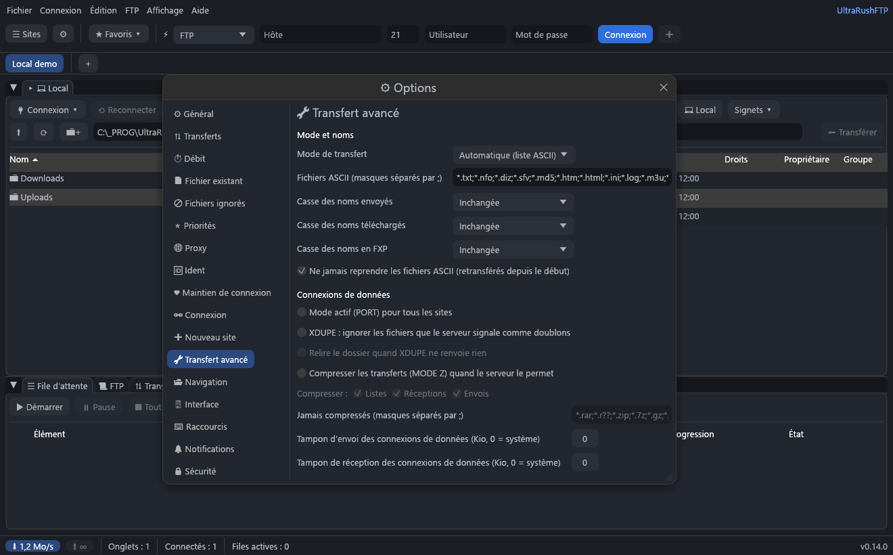

| Option | Défaut | Effet |
|---|---|---|
| Mode de transfert | Automatique | Automatique : ASCII pour les fichiers de la liste ASCII, binaire pour les autres ; ou toujours binaire / toujours ASCII. *Modifier…* dans la file règle le mode d'un élément |
| Fichiers ASCII | `*.txt;*.nfo;*.diz;*.sfv;*.md5;*.htm;*.html;*.ini;*.log;*.m3u;*.cue;*.xml;*.csv` | Masques de la liste ASCII |
| Casse des noms envoyés / téléchargés, casse des noms en FXP | Inchangée | minuscules ou MAJUSCULES pour les noms créés sur la cible |
| Ne jamais reprendre les fichiers ASCII | activé | Leur taille change avec les fins de ligne : retransférés depuis le début |
| Mode actif (PORT) pour tous les sites | désactivé | Connexions de données en mode actif quel que soit le réglage du site |
| XDUPE | désactivé | `SITE XDUPE 3` après la connexion ; les doublons listés dans un envoi refusé sont ignorés, et les suivants du dossier ne sont même pas essayés |
| Relire le dossier quand XDUPE ne renvoie rien | désactivé | Un envoi refusé sans noms `X-DUPE` : si la cible existe malgré tout (`SIZE`), le fichier est ignoré comme doublon |
| Compresser les transferts (MODE Z) | désactivé | Quand le serveur annonce `MODE Z` ; jamais pour les masques de *Jamais compressés* (archives, vidéo, images par défaut) |
| Compresser : Listes, Réceptions, Envois | tous activés | Ce à quoi `MODE Z` s'applique |
| Tampon d'envoi / tampon de réception des connexions de données (Kio) | 0 (système) | Réglés à part (le tampon unique d'une version précédente remplit les deux) ; un site peut remplacer chacun |
| Recul avant de reprendre un téléchargement (Kio) | 0 | La fin d'un fichier partiel est coupée avant la reprise |
| Espace à garder libre sur le disque local (Mio) | 0 | Un téléchargement qui en laisserait moins échoue |
| Pas de limite de vitesse pour le réseau local | désactivé | Sites à une adresse privée, de bouclage ou de lien local |
| Vérifier les téléchargements avec le fichier SFV | désactivé | CRC32 de chaque fichier téléchargé comparé au SFV de son dossier ; un SFV téléchargé en dernier vérifie les fichiers déjà là |
| Tenir un dossier d'état à côté des fichiers vérifiés | désactivé | Un dossier vide `[UltraRushFTP] - ( 7 of 10 files OK = 70% ) - INCOMPLETE` (ou `COMPLETE`, ou `, 2 BAD … - BAD FILES`), remplacé après chaque vérification |
| Vérifier les envois et le FXP avec XCRC | désactivé | Quand le serveur connaît `XCRC` |
| Supprimer un fichier au CRC faux et le transférer à nouveau | activé | Sinon le CRC faux est seulement noté au journal |
| Plusieurs fichiers SFV dans un dossier : n'en prendre aucun | désactivé | |
| Supprimer les dossiers cibles laissés vides par un transfert | désactivé | À la fin de la file (contenu ignoré) |
| Garder la date du serveur sur les fichiers téléchargés | désactivé | `MDTM` (ou les attributs SFTP) |
| Entrer dans un dossier après l'avoir créé | désactivé | `📁+` / `F7` dans un panneau |
| Ne pas transférer un sous-dossier qui porte le nom de son parent | désactivé | `release/release`, une erreur courante |
| Supprimer le fichier cible de 0 octet quand la source d'un FXP refuse | activé | |

### Navigation

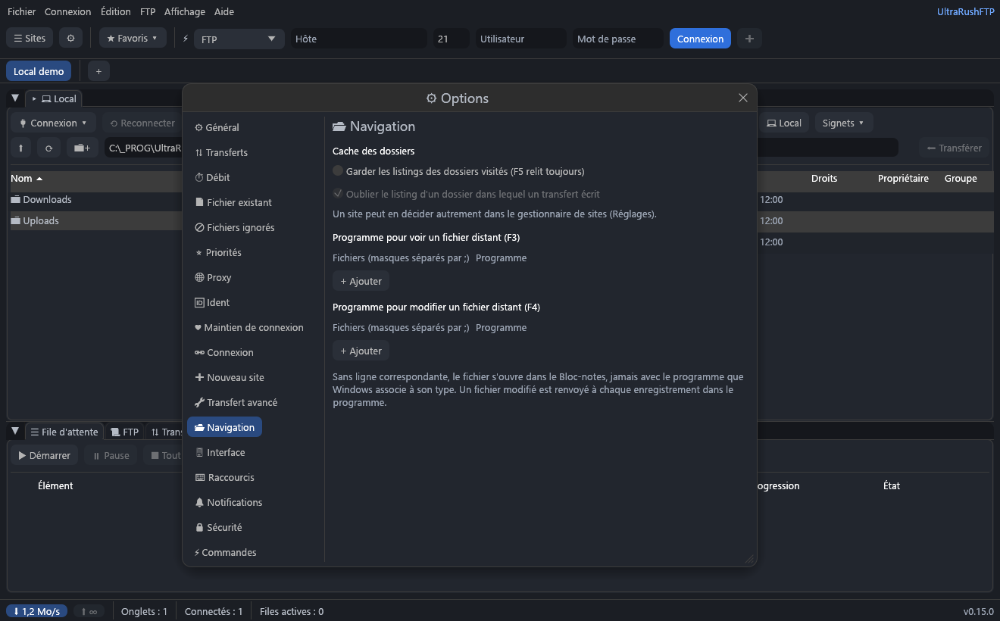

| Option | Défaut | Effet |
|---|---|---|
| Garder les listings des dossiers visités | désactivé | Un dossier revisité est montré de mémoire ; `F5` relit toujours le serveur. Une fiche de site peut dire oui ou non |
| Oublier le listing d'un dossier dans lequel un transfert écrit | activé | Avec le cache : les dossiers cibles des transferts sont relus |
| Programme pour voir un fichier distant (`F3`) | — | Lignes de masques (`*.nfo;*.txt`) et un programme ; la première ligne qui correspond sert |
| Programme pour modifier un fichier distant (`F4`) | — | Idem ; le fichier est surveillé et renvoyé sur le serveur à chaque enregistrement dans le programme |

Le fichier est téléchargé dans `%TEMP%\UltraRushFTP\files`. Sans ligne correspondante, il
s'ouvre dans le Bloc-notes : jamais avec le programme que Windows associe à son type, qui
pourrait lancer un programme téléchargé.

### Interface

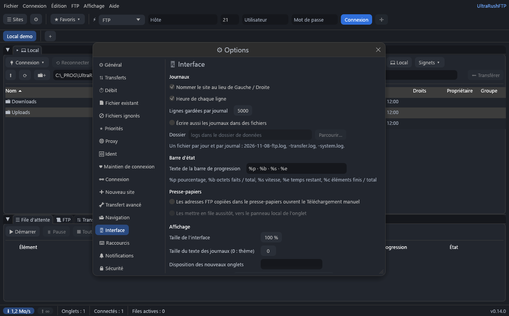

| Option | Défaut | Effet |
|---|---|---|
| Nommer le site au lieu de Gauche / Droite | activé | Dans les journaux FTP et transferts |
| Heure de chaque ligne | activé | |
| Lignes gardées par journal | 5000 | |
| Écrire aussi les journaux dans des fichiers | désactivé | Un fichier par jour et par journal ; dossier : `logs` du dossier de données s'il est vide |
| Texte de la barre de progression | `%p · %b · %s · %e` | Voir *Journaux et barre d'état* |
| Presse-papiers : les adresses ouvrent le Téléchargement manuel / mise en file aussitôt | désactivé | |
| Taille de l'interface | 100 % | Tout, texte et contrôles |
| Taille du texte des journaux | 0 (thème) | |
| Disposition des nouveaux onglets | — | Nom d'une disposition enregistrée (Affichage → Dispositions) |
| Police de l'interface / des listes de fichiers / des journaux | Police du thème | Une police TrueType ou OpenType du dossier des polices de Windows, par son nom ; une police illisible est signalée dans le journal système et la police du thème reste |
| Onglets sous les panneaux | désactivé | |
| Onglets sur plusieurs lignes quand ils ne tiennent pas | désactivé | |
| Largeur minimale d'un onglet | 0 (son titre) | En points |
| Grands boutons dans les barres d'outils | désactivé | Barre du haut, barres des panneaux, barre de la file |
| Bouton Favoris scindé | désactivé | Sa partie principale se connecte au dernier site |
| Tailles des fichiers | Dynamique | **Octets** (`1 234 567 o`), **Ko** (`1 206 Ko`, arrondi au-dessus) ou **Dynamique** (o, Ko, Mo, Go…) dans les listes de fichiers |
| Afficher les fichiers et dossiers cachés dans les panneaux locaux | activé | Éléments avec l'attribut Windows *caché* |
| Clic droit dans un panneau local : menu de l'Explorateur Windows | désactivé | Le menu de Windows pour la sélection (Ouvrir avec, Envoyer vers, Propriétés…) ; le menu d'UltraRushFTP reste dans les menus Édition et FTP, et son entrée *Menu de l'Explorateur Windows…* donne le menu de Windows quand l'option est désactivée |
| Relire le dossier d'un téléchargement en cours toutes les | 0 s (jamais) | Le panneau local qui montre le dossier d'un téléchargement en cours est relu, pour suivre la taille du fichier |
| Colonnes ajustées à leur contenu : Local, Distant, File | désactivé | Colonnes taille, date et attributs ajustées à ce qu'elles montrent |
| Dossiers avant les fichiers | activé | |
| Lister les liens à part | désactivé | Liens (🔗) entre les dossiers et les fichiers |
| Taille et date : plus grand / plus récent d'abord | désactivé | Premier clic sur ces colonnes |
| Noms surlignés | — | Masques et une couleur par thème ; le contraste contre les fonds des listes est affiché (4,5:1 au moins est conseillé) |
| Mes propres couleurs pour les lignes des journaux | désactivé | Commande, réponse, état, erreur, par thème, avec leur contraste |
| Couleur propre des barres de progression | désactivé | Par thème, avec son contraste |
| Double-clic sur un fichier | Le transférer | Ou l'afficher (fichiers distants), ou rien |
| Double-clic sur une ligne de journal | Copier la ligne | Ou rien |
| Double-clic sur un site du gestionnaire | Se connecter | Ou rien |
| Double-clic sur le titre d'un panneau de fichiers | Rien | Actualiser, dossier parent, ou basculer entre local et distant |
| Double-clic sur un onglet | Rien | Nouvel onglet des mêmes sites, ou fermer l'onglet |
| Double-clic sur un élément de la file | Rien | Le modifier, le réessayer (élément en échec ou arrêté) ou le retirer |
| Confirmations | quitter, fermer un onglet occupé : activé ; retirer de la file : désactivé | Quitter quand des éléments restent à transférer ; fermer un onglet avec des connexions ou une file ; retirer des éléments de la file |
| Commandes de site | `SITE HELP`, `SITE WHO`, `SITE NEW`, `SITE SEARCH %1`, `SITE STAT`, `SYST` + `FEAT` | Nom et commandes (une par ligne) du menu FTP › Commandes de site |

### Raccourcis

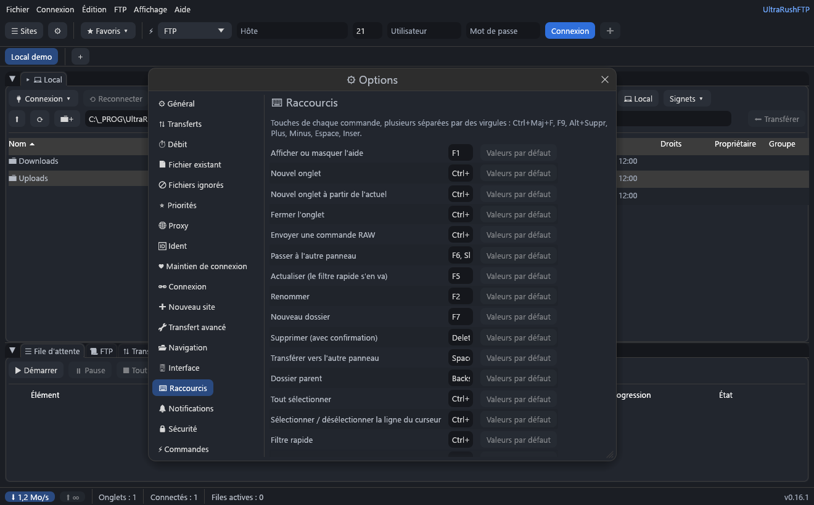

Touches de chaque commande, plusieurs séparées par des virgules (`Ctrl+Maj+F, F9`,
`Alt+Suppr`, `Plus`, `Minus`, `Espace`, `Inser`). Une touche non comprise garde les
touches par défaut ; les touches données à plusieurs commandes sont signalées. `F1`
montre les touches en vigueur. Les flèches, `Entrée`, `Échap`, `Tab`, `Ctrl+Tab` et
`Ctrl+V` ne se changent pas.

### Notifications

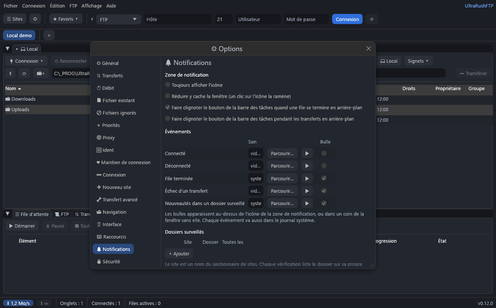

| Option | Défaut | Effet |
|---|---|---|
| Toujours afficher l'icône | désactivé | Icône dans la zone de notification ; un clic affiche la fenêtre |
| Réduire dans la zone de notification | désactivé | |
| Faire clignoter le bouton de la barre des tâches à la fin d'une file en arrière-plan | activé | |
| Faire clignoter le bouton de la barre des tâches pendant les transferts en arrière-plan | désactivé | S'arrête à leur fin ou quand la fenêtre revient au premier plan |
| Événements : son, bulle | file terminée et nouveautés : son Windows et bulle ; échec d'un transfert : bulle | Son : vide, `system` ou un fichier `.wav` (`▶` l'écoute) ; bulles au-dessus de l'icône, ou dans un coin de la fenêtre sans elle ; chaque événement va aussi dans le journal système |
| Dossiers surveillés | — | Site (nom du gestionnaire), dossier, intervalle ; chaque vérification liste le dossier sur sa propre connexion et les nouveaux noms sont signalés (la première lecture ne fait que noter) |

### Sécurité

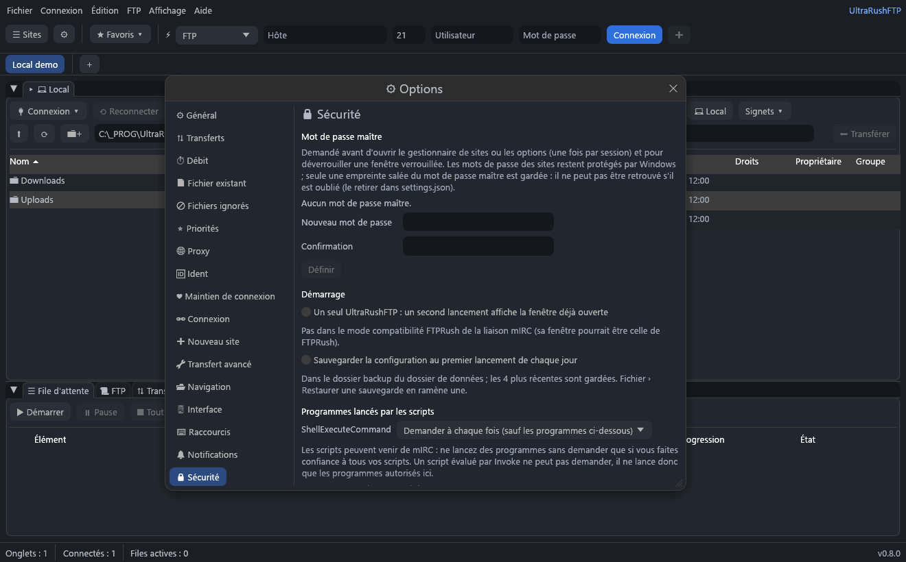

| Option | Défaut | Effet |
|---|---|---|
| Mot de passe maître | aucun | Demandé avant le gestionnaire de sites et les options (une fois par session) et pour déverrouiller *Fichier → Verrouiller*. Seule une empreinte salée PBKDF2-SHA256 est gardée ; les mots de passe des sites restent protégés par Windows (DPAPI). Un mot de passe maître oublié ne se retrouve pas : retirer `master_hash` de `settings.json` |
| Un seul UltraRushFTP | désactivé | Un second lancement affiche la fenêtre déjà ouverte (pas dans le mode compatibilité FTPRush de la liaison mIRC) |
| Sauvegarder la configuration chaque jour | désactivé | Au premier lancement du jour, dans `backup` du dossier de données ; 4 gardées |
| ShellExecuteCommand | Demander à chaque fois | Ce que reçoit un script qui demande à lancer un programme : une question qui montre l'origine du script, le programme, ses paramètres et son dossier (*Le lancer*, *Toujours autoriser ce programme*, *Refuser*) ; *Les lancer sans demander* ; *Ne jamais lancer de programme*. Les scripts évalués par `Invoke` ne peuvent pas demander : ils ne lancent que les programmes autorisés |
| Programmes toujours autorisés | aucun | Programmes autorisés par *Toujours autoriser ce programme* ; `✕` retire l'autorisation |

### Sauvegardes

**Fichier → Sauvegarder la configuration** copie les fichiers du dossier de données
(sites, options, statistiques, dispositions, file non terminée) dans
`backup\<date>_<heure>`. **Fichier → Restaurer une sauvegarde** remet ses fichiers et
ferme UltraRushFTP, qu'il faut relancer. Les mots de passe d'une sauvegarde ne marchent
que pour le même compte Windows.

## Fiche de site


Dans l'arbre des sites, un site se déplace en le glissant sur un dossier (à la fin de celui-ci)
ou sur un autre site (avant lui) ; un dossier glissé sur un autre dossier va dedans.

| Champ | Défaut | Remarques |
|---|---|---|
| Nom | « Nouveau site » | Utilisé par les scripts, mIRC et `urftp` (insensible à la casse) |
| Description | vide | Texte court affiché à côté du nom dans l'arbre des sites |
| Protocole | FTP | FTP, FTPS explicite, FTPS implicite, SFTP ; le port suit (21, 990, 22) |
| Hôte, port | — / 21 | Nom ou adresse IP ; quand un nom a des adresses IPv6 et IPv4, les deux sont essayées (« happy eyeballs ») |
| UTF-8 forcé | non | FTP : `OPTS UTF8 ON` est envoyé et les noms sont lus en UTF-8 même si le serveur n'annonce pas `UTF8` (remplace le jeu de caractères) |
| Envoyer l'identifiant en UTF-8 | non | FTP : `USER` et `PASS` en UTF-8 quand le site utilise un autre jeu de caractères |
| PASV uniquement (pas d'EPSV) | non | FTP : mode passif par `PASV` seulement. Pour les bouncers : `EPSV` ne donne qu'un port, la connexion de données part donc vers le bouncer, qui ne la fait pas suivre ; `PASV` donne l'adresse du vrai serveur. Sans cette option, une connexion de données qui échoue après `EPSV` fait passer la connexion en `PASV` |
| Le serveur est derrière un NAT | non | FTP : les connexions de données vont toujours à l'adresse du serveur, quoi que réponde `PASV` (sinon seulement quand `PASV` donne une adresse privée pour un serveur public) |
| Autres adresses | aucune | `hôte:port` (ou `[IPv6]:port`), une par ligne : essayées à tour de rôle quand l'adresse principale ne répond pas ou refuse la connexion ; celle qui a marché sert en premier la fois suivante |
| Utilisateur, mot de passe, anonyme | — | Mot de passe chiffré par DPAPI ; avec une clé SSH, c'est sa phrase de passe |
| Site activé | oui | Un site désactivé ne peut pas être connecté (`RushApp.FTP.DisableSite`) |
| Chiffrer aussi les transferts (PROT P) | oui | FTPS : canaux de données des transferts chiffrés |
| Chiffrer aussi les listings (PROT P) | comme les transferts | FTPS : canaux de données des listings chiffrés |
| Utiliser AUTH SSL au lieu d'AUTH TLS | non | FTPS explicite : `AUTH SSL` est envoyé d'abord (`AUTH TLS` s'il est refusé), pour les serveurs qui raccrochent sur `AUTH TLS` (mode *AUTH SSL* de FTPRush) |
| Envoyer PBSZ 0 après l'authentification TLS | oui | FTPS : à désactiver pour les serveurs qui le refusent |
| FXP chiffré (FTP à FTP) | Automatique | Automatique (`SSCN` quand il est annoncé, sinon `CPSV`), Ne pas utiliser (canal de données en clair entre les serveurs), Utiliser |
| Certificat | Vérifier avec les autorités Windows | ou Accepter tout certificat (déconseillé), ou Certificat approuvé (empreinte SHA-256, remplie quand on approuve un serveur) |
| Clé privée | aucune | SFTP : fichier de clé OpenSSH, PEM ou PuTTY `.ppk` |
| Autres clés | aucune | SFTP : essayées à tour de rôle quand le serveur refuse la précédente ; le mot de passe est la phrase secrète de chaque clé |
| Clés de serveur approuvées | aucune | Empreintes de clés d'hôte SFTP (`SHA256:…`) ajoutées quand on approuve un serveur |
| Mode | Passif | Passif ou Actif (`PORT`/`EPRT`) ; voir aussi le repli `PORT` de la page Connexion |
| Transferts simultanés | 2 | 0 = connexion unique |
| Max. téléchargements / Max. envois | non fixé | Limites supplémentaires par sens |
| Dossier distant, dossier local | vides | Ouverts à la connexion |
| FXP depuis ce site : jamais PASV | non | FXP : ce site se connecte toujours (`PORT`), l'autre écoute |
| FXP vers ce site : toujours PASV | non | FXP : ce site écoute toujours ; sinon la source écoute et les rôles s'inversent quand `PORT` est refusé |
| Proxy | Réglage global | Réglage global, Jamais de proxy, proxy propre au site (mêmes champs que le proxy global), ou l'un des proxys nommés |
| Nom Ident propre à ce site | non | Répondu par le serveur Ident pendant la connexion du site (le serveur doit être activé) |
| Signets | aucun | Nom, dossier distant, dossier local ; utilisés par `RS_BOOKMARK` dans les scripts |
| Notes | vide | Texte libre |
| Journaux : le nom du site au lieu de Gauche / Droite | non | Quelle que soit l'option de la page Interface |
| Notifier les nouveaux dossiers et fichiers, dossiers | non, aucun | Dossiers du site relus à leur intervalle (minutes) ; les nouveaux noms sont notifiés comme le règle Options › Notifications (comme les dossiers surveillés de cette page) |
| Statistiques | — | Ce serveur : dernier accès, connexions, envoyé, reçu, FXP depuis et vers lui, totaux (*Remettre ce serveur à zéro*). Tous les serveurs depuis la première utilisation : totaux et moyenne par jour (*Copier*, *Remettre tous les serveurs à zéro*). Cette session : totaux (*Copier la session*). Gardées dans `stats.json` |
| Adresse web : adresse du dossier, dossier distant servi à cette adresse | vide, `/` | Pour *Copier l'adresse HTTP* : `https://www.example.com/files` et `/pub` transforment `/pub/a b.zip` en `https://www.example.com/files/a%20b.zip` |

**Listing** (FTP et FTPS) :

| Champ | Défaut | Remarques |
|---|---|---|
| Commande de listing | Réglage global | Réglage global (page Connexion), `STAT -l` (sur le canal de contrôle, sans connexion de données) ou une commande personnalisée |
| Fuseau horaire du serveur | Inconnu / ne pas modifier | UTC−12:00 à UTC+14:00 : remplit le décalage ci-dessous d'après le fuseau local |
| Décalage horaire | 0 h | Heures (quarts d'heure possibles) ajoutées aux dates des listings, pour un serveur dans un autre fuseau horaire |
| Jeu de caractères | UTF-8 (automatique) | Pour les serveurs qui n'utilisent pas UTF-8 : windows-1252, ISO-8859-1/2/15, windows-1250/1251, KOI8-R, Shift_JIS, EUC-JP, GBK, gb18030, Big5, EUC-KR, IBM866. Noms, chemins et réponses sont convertis ; `OPTS UTF8 ON` n'est alors pas envoyé, et un nom que le jeu ne sait pas écrire est refusé |
| Retirer les espaces en début de ligne du listing | non | Pour les serveurs dont les lignes de `LIST` commencent par des espaces (toujours fait pour `STAT`) |
| Format du listing | Automatique | Automatique (Unix ou DOS/IIS ligne par ligne), Unix, DOS / IIS |

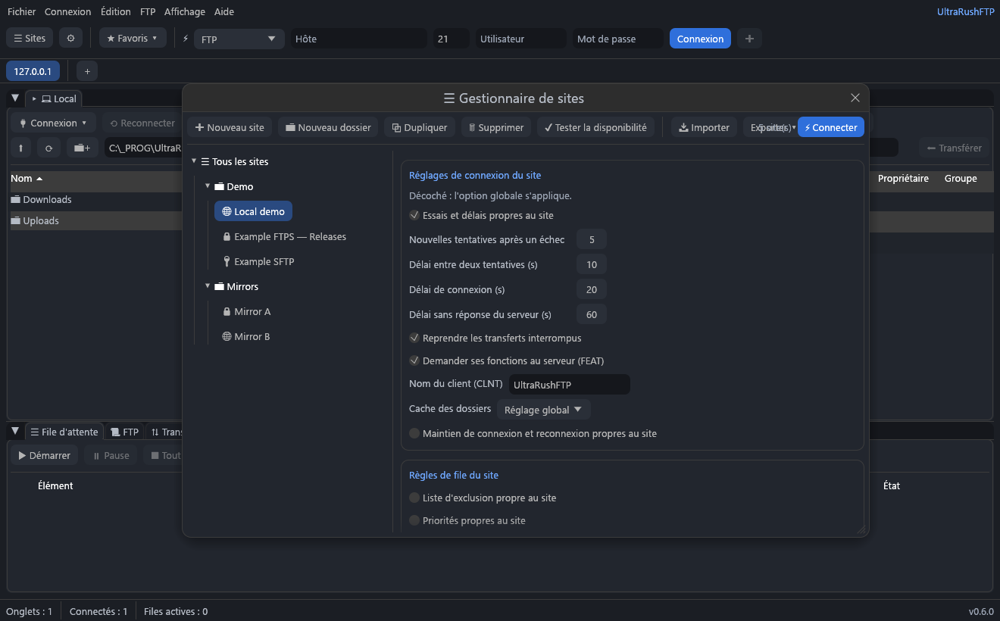

**Réglages du site** (sections *Réglages de connexion du site*, *Règles de file du site*,
*Comptes séparés*). Un réglage décoché suit l'option globale.

| Champ | Défaut | Remarques |
|---|---|---|
| Essais et délais propres au site | non | Nombre d'essais, délai entre deux essais, délais de connexion et de réponse ; ils partent des valeurs globales (page Transferts) |
| Reprise des transferts interrompus | Détection auto | Détection auto : reprendre, et suivre *Recommencer depuis le début si la reprise est refusée* quand le serveur refuse `REST` ; Oui : toujours reprendre (un `REST` refusé fait échouer le transfert) ; Non : toujours depuis zéro |
| Cache des dossiers | Réglage global | Oui / Non remplace *Garder les listings des dossiers visités* pour ce site |
| Demander ses fonctions au serveur (FEAT) | oui | FTP : à désactiver pour les vieux serveurs qui n'aiment pas `FEAT` (`MLSD`, `PRET`, `UTF8` ne sont alors pas détectés) |
| Choisir les fonctions utilisées | non (toutes) | FTP : `PRET`, UTF-8 (`OPTS UTF8`), `MODE Z`, `XCRC`, `MLSD`, `SSCN`, `CPSV` ; une fonction décochée n'est pas utilisée même si le serveur l'annonce |
| Nom du client (CLNT) | vide | FTP : envoyé par `CLNT` après la connexion (vide : pas envoyé) |
| Transferts propres au site | Réglage global | FTP : casse des noms envoyés, téléchargés et en FXP ; XDUPE ; Relire le dossier quand XDUPE ne renvoie rien ; NOOP pendant les transferts ; tampons d'envoi et de réception (Kio) |
| Maintien de connexion et reconnexion propres au site | non | Mêmes champs que la page Maintien de connexion |
| Liste d'exclusion / priorités / règles « fichier existant » propres au site | non | Mêmes champs que les pages correspondantes (les règles « fichier existant » par sens) ; la liste d'exclusion et les priorités du site d'où viennent les fichiers s'appliquent, les règles « fichier existant », les essais et la reprise du site où ils vont |
| Compte pour les envois / pour les téléchargements | non | Adresse et port (vides : ceux du site), identifiant et mot de passe utilisés par les transferts dans ce sens (et les dossiers créés ou listés pour eux) ; la navigation garde le compte principal |

**Connecter** (gestionnaire de sites) : `Maj` enfoncée pour une connexion fantôme
(`!user` : le serveur ferme les autres sessions du compte) et `Ctrl` pour `-motdepasse`
(glftpd et d'autres : pas de messages d'accueil). FTP et FTPS seulement.

**Tester la disponibilité** (barre d'outils du gestionnaire de sites) : se connecte au
site sélectionné, ou à tous les sites actifs du dossier sélectionné en même temps, puis se
déconnecte. L'arborescence affiche le temps de réponse (`✔ 120 ms`) ou `✖` ; la fiche du
site indique l'adresse qui a répondu ou l'erreur.

**Import** (barre du gestionnaire de sites) : FileZilla (`sitemanager.xml` ou export),
FTPRush v3 (`site.json`), FTPRush v1/v2 (`RushSite.xml`), FlashFXP (`.ftp`). Le format est
détecté automatiquement ; les fichiers trouvés sur cet ordinateur sont proposés
directement. Les mots de passe ne sont pas importés depuis FTPRush v1/v2 et FlashFXP. Un
fichier texte d'une adresse par ligne (`ftp://utilisateur:motdepasse@hôte:port/dossier`)
s'importe aussi, un site par adresse.

**Exporter ▾** : les sites du dossier sélectionné (ou tous les sites) en adresses
(texte), en tableau (CSV), en page web (HTML) ou en `RushSite.xml` de FTPRush v2. Les
mots de passe ne sont jamais exportés. **☰ Liste** montre tous les sites dans une liste
triable par nom, hôte, type ou dossier (**📁 Dossiers** revient à l'arborescence).

## Ligne de commande

Options de démarrage de `UltraRushFTP.exe` (syntaxe de FTPRush v2, `-` ou `/`) :

| Option | Effet |
|---|---|
| `-w<n>` | Ouvrir n onglets (1 à 50) |
| `-c<url>` | Se connecter : `ftp://user:pass@hôte:port/`, `ftps://` (explicite), `ftpsi://` (implicite), `sftp://`, le nom d'un site du gestionnaire, ou un hôte seul (FTP anonyme) |
| `-f"dossier"` | Réglages et sites dans ce dossier ; `-f` seul : le dossier du programme (mode portable) |
| `-r[t][x]` | Lancer les files au démarrage ; `t` : réduire la fenêtre ; `x` : quitter quand il ne reste rien à transférer |
| `-s"fichier"` | Exécuter ce Pascal Script au démarrage (ajout d'UltraRushFTP) |
| `-d` | Mode débogage (accepté ; le journal est déjà complet) |
| `-b` | Option de licence « BetaUser » de FTPRush v2 : ignorée |

Les options inconnues sont signalées dans la console de script.

## Outil `urftp`

```text
urftp [options] <commande> [arguments]
```

| Commande | Effet |
|---|---|
| `sites` | Liste les sites du gestionnaire |
| `ls <cible>` | Liste un dossier distant |
| `get <cible> [dossier local]` | Télécharge un fichier ou un dossier (dossier courant par défaut) |
| `put <fichier\|dossier> <cible>` | Envoie dans le dossier distant |
| `fxp <source> <destination>` | Transfert de site à site |
| `raw <site> <commande>...` | Commandes FTP brutes, réponses affichées |

Une *cible* est `NomDuSite:/chemin` (gestionnaire de sites, nom insensible à la casse ;
`NomDuSite` seul = son dossier distant) ou une URL `ftp://user:pass@hôte:port/chemin`
(`ftps://`, `ftpsi://`, `sftp://` ; les codes `%XX` sont décodés).

| Option | Effet |
|---|---|
| `-v`, `--verbose` | Journal du protocole sur stderr (mot de passe masqué) |
| `-n`, `--transfers <n>` | Transferts simultanés par site |
| `--exists <action>` | Fichier existant : `overwrite`, `resume`, `skip`, `rename` |
| `--insecure` | Accepter tout certificat TLS |
| `--fingerprint <emp.>` | Empreinte SHA-256 attendue (certificat FTPS ou clé d'hôte SFTP) |
| `--data <dossier>` | Dossier des réglages (comme `-f`) |
| `--lang <en\|fr>` | Langue des messages (défaut : l'option, puis Windows) |
| `-h`, `--help` | Aide |

Codes de sortie : `0` tout est transféré, `1` échec (connexion, commande refusée,
transfert incomplet), `2` arguments invalides.

## Scripts (`RushApp`)

Pascal Script comme dans FTPRush v2, exécuté depuis la console *Script*, `-s`,
`URUSHFTP_SCRIPT` ou mIRC. Chaque script tourne à côté de l'interface : la fenêtre reste
utilisable, `InputQuery` ouvre une boîte de saisie et l'attend, et la console affiche
*Script en cours…* avec un bouton **■ Arrêter** (le script s'arrête à son prochain appel à
l'application). **Ouvrir…**, **Enregistrer** et **Enregistrer sous…** chargent et écrivent le
texte de la console dans un fichier `.pas`. `Invoke` évalue son expression aussitôt : un `InputQuery` n'y reçoit donc
pas de réponse.

Langage géré :

- variables (`var a, b;`, types facultatifs et ignorés, ou implicites),
  `const NOM = valeur;`, chaînes (`'…'`, `#13#10`), entiers (`$1F`), booléens, `nil` ;
- tableaux : `A := [2, 4, 6]` (à partir de 0), imbriqués `[[…], […]]` lus par `M[0, 2]` ou
  `M[0][2]` et affectés par `M[1, 1] := x` ; chaînes indexées à partir de 1
  (`S[1] := 'A'`) ; `x in [1, 2]` ; `SetLength`, `Length`, `Low`, `High` ;
- opérateurs (`or`/`and`/`xor` bit à bit sur les drapeaux), `if/then/else`,
  `case … of` (étiquettes de tout type, plusieurs par branche, intervalles `1..5`, `else`),
  `while`, `repeat/until`, `for … to/downto`, `break`, `continue`, `begin/end`, `exit` ;
- `procedure` et `function` déclarées avant les instructions, avec paramètres, paramètres
  `var` (par référence), `var` locales, `Result` ou le nom de la fonction pour la valeur,
  récursivité (64 niveaux) ;
- fonctions intégrées `IntToStr`, `StrToInt`, `StrToIntDef`, `Length`, `UpperCase`,
  `LowerCase`, `Trim`, `Copy`, `Pos`, `Chr`, `Ord`, `Abs`, `Odd`, `ShowMessage`,
  `InputQuery` ; bibliothèque FTPRush : `MatchExpr(texte, regex)`,
  `MatchString(texte, jokers)` (sans tenir compte de la casse, comme les filtres de
  transfert), `ShellExecuteCommand(programme, paramètres, dossier, drapeau)` (voir
  *Options › Sécurité* ; `drapeau` n'est pas utilisé).

| Procédures | Propriétés (lecture) | Propriétés (écriture) |
|---|---|---|
| `RushApp.FTP.Login`, `Logout`, `CWD`, `RAW`, `Delete`, `Transfer`, `RemoveQueue`, `EnableSite`, `DisableSite` ; `RushApp.DeleteEmptyTabs` (`DeleteEmptyContainers`) ; `RushApp.UI.Selection.Prepare` | `RushApp.Version`, `Language`, `StartDate`, `DayCount`, `TotalDownloadSize`, `TotalUploadSize`, `TotalFxpSize`, `CurDownloadSize`, `CurUploadSize`, `CurFxpSize`, `DownloadBW`, `UploadBW`, `PoolInfo`, `FTP.Splitter`, `Containers.ContainerCount`, `Containers.ConnectedSiteCount`, `Containers.TransferSiteCount` ; `UI.Selection.Count`, `Items[i]` (`Name`, `Size`, `Date`, `Attr`, `Owner`, `Group`, `IsFolder`, `FullPath`), `IsRemoteSide`, `IsFTPConnected`, `FTPName` ; `UI.OnSwitchLayout` | `RushApp.FTP.Splitter`, `RushApp.UI.OnSwitchLayout` |

`RushApp.UI.Selection.Prepare` prend la sélection du panneau actif (la ligne sous le
curseur quand rien n'est sélectionné) ; les autres propriétés de `Selection` lisent ce
qu'elle a pris. `RushApp.UI.OnSwitchLayout := MaProcedure;` exécute `MaProcedure` (avec ou
sans paramètre `Sender`) chaque fois qu'une disposition enregistrée est chargée depuis
*Affichage → Dispositions* ; `:= nil` la retire. La procédure tourne seule : les variables
globales du script qui l'a donnée ne sont pas gardées. `RushApp.UI.Bar` et
`RushApp.UI.Menu` répondent par une erreur : l'aide de FTPRush n'en décrit aucun membre.

Drapeaux gérés : `RS_APPEND`, `RS_BOOKMARK`, `RS_CHECKBM`, `RS_CURRENT`,
`RS_DELEMPTYTABS`, `RS_DIRDES`, `RS_DIRSRC`, `RS_DOWN`, `RS_EXPR`, `RS_FAIL`, `RS_FILE`,
`RS_FOLDER`, `RS_FULLPATH`, `RS_GHOST`, `RS_INVERT` (`-motdepasse`), `RS_LOGIN`, `RS_LOGOUT`,
`RS_NOCIRCLE`, `RS_NOMKD`, `RS_NOSKIP`, `RS_NORMAL`, `RS_ONE`, `RS_PAIR`, `RS_POPUP`,
`RS_SORTDATE`, `RS_SORTDES`, `RS_SORTSIZE`, `RS_TRANSFER`, `RS_UP`, `RS_WAITING`.
`RS_CHECKLOGIN` (les sites du transfert sont d'abord testés par une connexion, en même
temps ; ceux qui la refusent sont laissés de côté et signalés dans le journal).

`RushApp.FTP.Transfer(Handle, SrcList, SrcFolder, SrcItem, DesList, DesFolder, DesItem,
Flag, FolderAllow, FolderSkip, FileAllow, FileSkip, CompleteFlag, RepeatCount, RetryCount,
Timeout, FolderSort, FileSort, Depth, SubCount)` :

- plusieurs paires partent chacune dans un nouvel onglet et tournent en même temps ; avec
  `RS_APPEND` (ou un `Handle`), elles partagent un onglet ; `RS_NOCIRCLE` fait attendre à
  chaque paire que la précédente soit entièrement terminée ;
- `FolderAllow` … `FileSkip` : masques séparés par `;` (`RS_EXPR` : expressions
  régulières), `%F%` / `%D%` devant un masque pour les fichiers / dossiers seulement ;
  `RS_NOSKIP` ignore la liste de fichiers ignorés ;
- `RepeatCount` : le dossier est relu ce nombre de fois pour attraper les nouvelles
  entrées, jusqu'à ce qu'un nom corresponde à `CompleteFlag` (expression régulière) ;
  `RetryCount` : tentatives des éléments ;
- `FolderSort` / `FileSort` : nom croissant par défaut, `RS_SORTDATE`, `RS_SORTSIZE`,
  `RS_SORTDES` ; `SubCount` : seulement les premières entrées de chaque dossier ; `Depth` :
  niveaux de sous-dossiers parcourus (0 : sans limite) ;
- `RS_LOGOUT` déconnecte les panneaux et `RS_DELEMPTYTABS` ferme l'onglet une fois sa file
  terminée ; `RS_NOMKD` correspond à la création habituelle des dossiers (on y entre quand
  ils existent) ; `Timeout` n'est pas utilisé, comme dans FTPRush.

## DLL mIRC

| Export | Usage |
|---|---|
| `LoadDll` / `UnloadDll` | Appelées par mIRC ; la DLL reste chargée |
| `Invoke` | `$dll(rushmirc.dll, Invoke, <expression>)` renvoie une valeur |
| `RushScript` | `/dll rushmirc.dll RushScript <script>` exécute un script ; les réponses des `RAW` reviennent dans mIRC |
| `RushCommand` | Pareil, sans les réponses |
| `EnableCallback` / `DisableCallback` | Active (par défaut) ou coupe les réponses des `RAW` |

Utiliser `mirc/x86/rushmirc.dll` pour mIRC 32 bits et `mirc/x64/rushmirc.dll` pour mIRC 64
bits.

La DLL trouve l'application par une fenêtre cachée. UltraRushFTP la nomme `TfmUltraRush`,
et sa DLL cherche d'abord `TfmUltraRush`, puis `TfmRush` (FTPRush). FTPRush v2 peut donc
tourner en même temps. Le `rushmirc.dll` **d'origine** de FTPRush ne connaît que `TfmRush` :
pour piloter UltraRushFTP avec lui, cocher *Compatibilité avec la DLL mIRC de FTPRush*
(Options › Général). FTPRush v2 cherche cette même fenêtre à son démarrage et ne s'ouvre pas
tant qu'elle existe. Quand une fenêtre `TfmRush` est déjà ouverte (FTPRush lancé),
UltraRushFTP n'en crée pas une seconde et le signale dans le journal.

## Variables d'environnement

| Variable | Effet |
|---|---|
| `URUSHFTP_DATA` | Dossier des réglages (remplacé par `-f` / `--data`) |
| `URUSHFTP_LANG` | `en` ou `fr` : impose la langue (interface et `urftp`) |
| `URUSHFTP_THEME` | `light` (ou `clair`) / autre valeur : impose le thème au démarrage |
| `URUSHFTP_CONNECT` | URL connectée au démarrage (comme `-c`) |
| `URUSHFTP_SCRIPT` | Source d'un script exécuté au démarrage |
| `URUSHFTP_IPC_CLASS` | Classe de fenêtre de la liaison mIRC à la place de `TfmUltraRush` / `TfmRush`, pour l'application et pour la DLL (tests) |
| `URUSHFTP_OPEN_SITES` | Développement : ouvre le gestionnaire de sites sur ce numéro de site |
| `URUSHFTP_SITE_SETTINGS` | Développement : garde la fiche du site défilée sur les réglages du site |
| `URUSHFTP_OPEN_OPTIONS` | Développement : ouvre la fenêtre Options sur cette page (0 à 16) |
| `URUSHFTP_OPEN_SHORTCUTS` | Développement : ouvre la fenêtre des raccourcis clavier |
| `URUSHFTP_SHOW_PANES` | Développement : `windows,tasks` ajoute la liste des fenêtres et la fenêtre des tâches au premier onglet |
| `URUSHFTP_OPEN_ABOUT` | Développement : ouvre la fenêtre À propos |

## Fichiers

Dans le dossier des données (`%APPDATA%\UltraRushFTP` par défaut) :

| Fichier | Contenu |
|---|---|
| `sites.json` | Carnet de sites (mots de passe `dpapi:…`) ; écriture atomique, version précédente gardée dans `sites.json.bak` |
| `settings.json` | Options ci-dessus (mot de passe du proxy `dpapi:…`) ; les clés absentes prennent leur valeur par défaut |
| `stats.json` | Totaux des transferts et date de première utilisation (`RushApp.Total*`, `StartDate`) |
| `queue.json` | File non terminée de chaque onglet (supprimé quand il ne reste rien à faire) |
| `*.urq` | Fichiers de file enregistrés à la main (n'importe où), même format que `queue.json` |
| `layouts.json` | Dispositions des panneaux enregistrées |
| `tasks.json` | Tâches planifiées (fenêtre des tâches) |
| `logs\` | Fichiers journaux (quand ils sont écrits sur disque) |
| `backup\` | Sauvegardes de la configuration |
