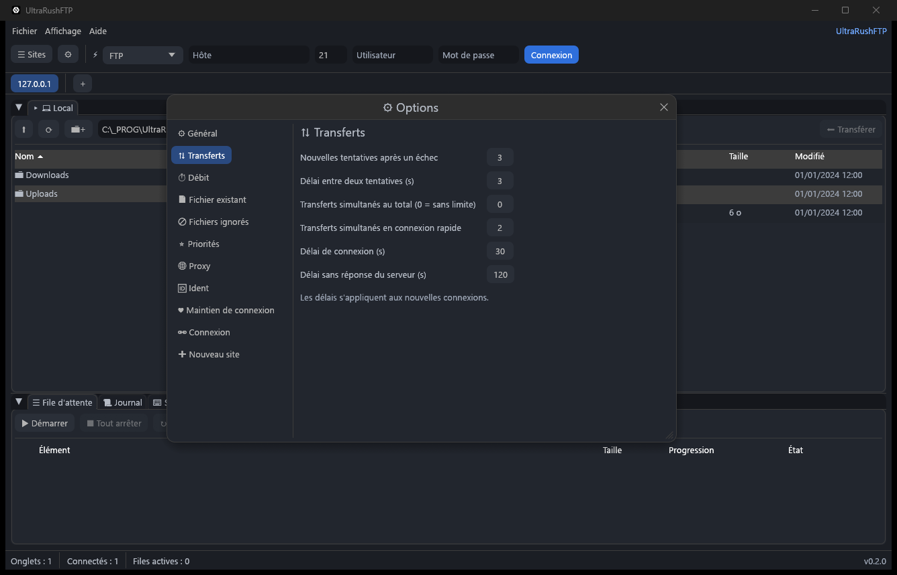
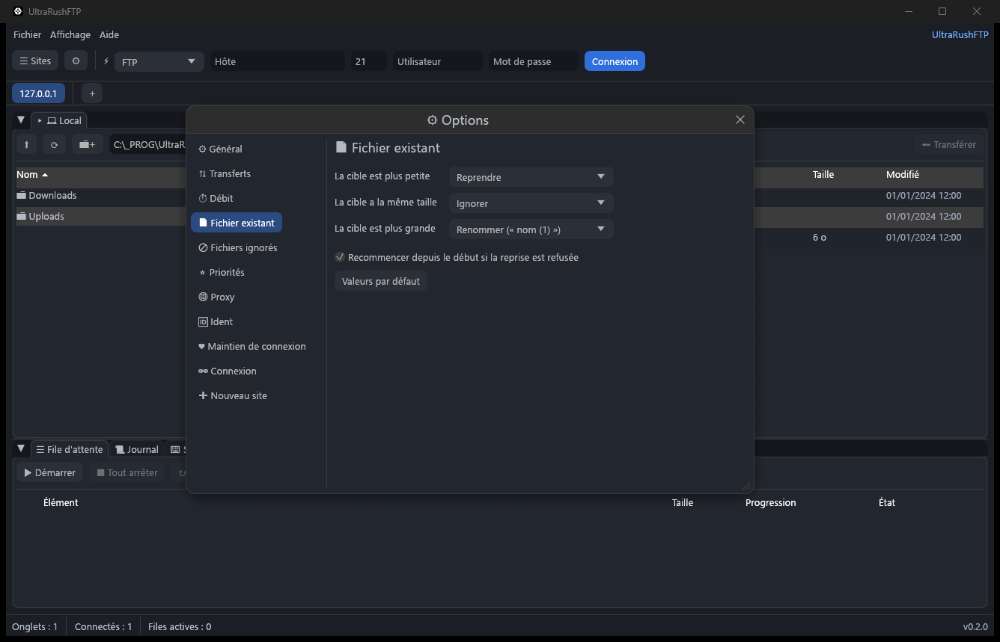
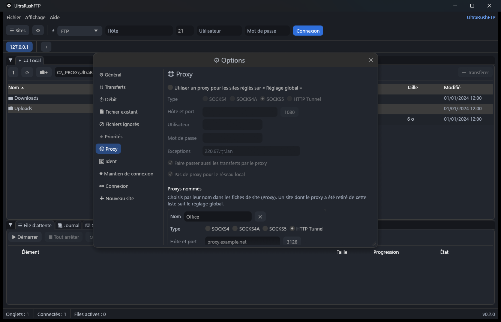
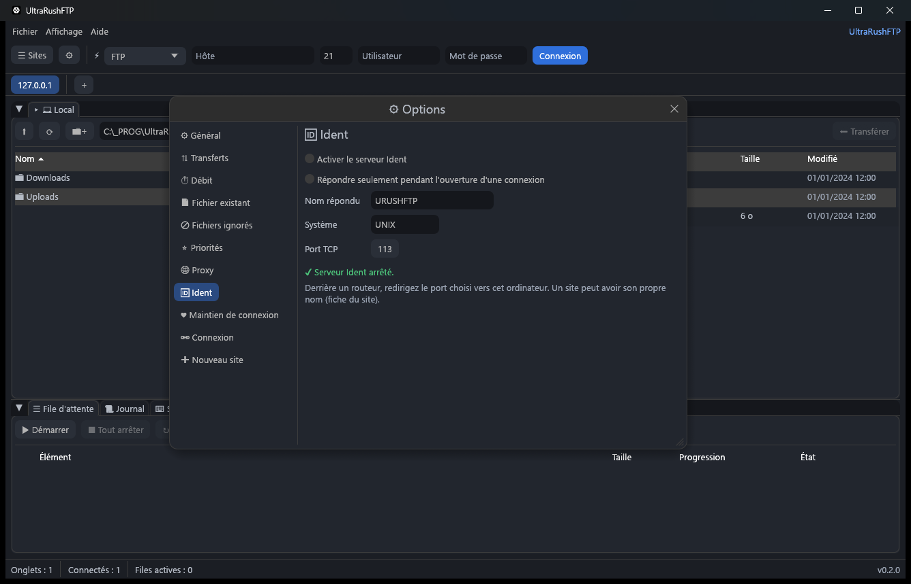
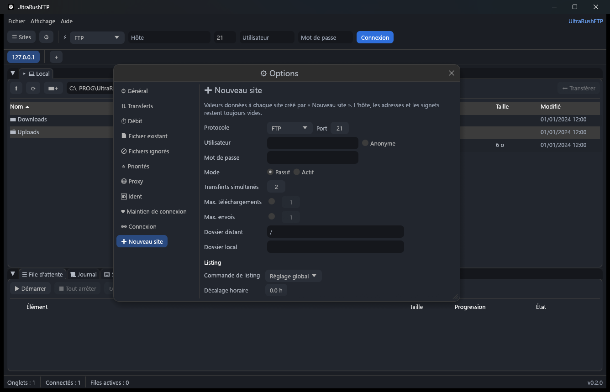
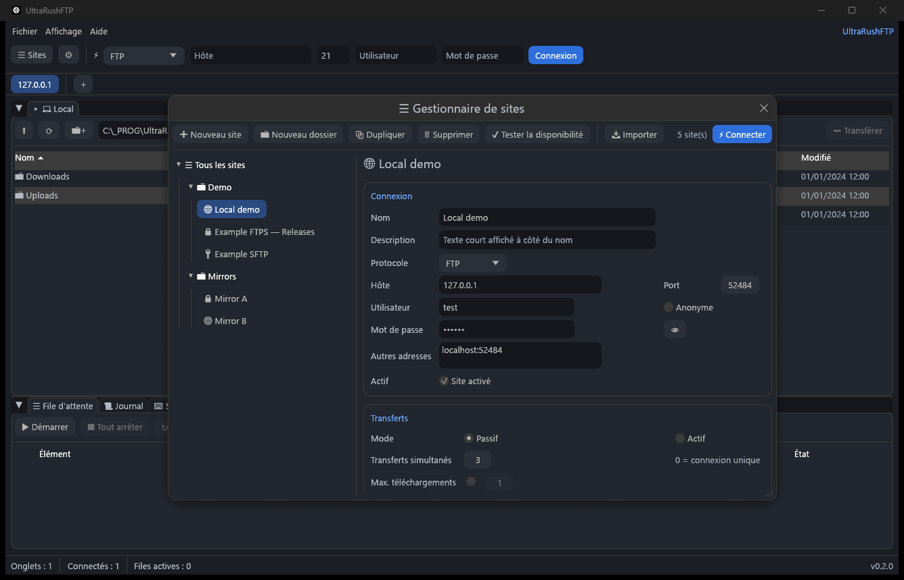

# Référence des options

[English](OPTIONS.md) | **Français**

Tous les réglages d'UltraRushFTP, avec leur valeur par défaut. Sommaire :
[interface](#interface) · [fenêtre Options](#fenêtre-options) ·
[fiche de site](#fiche-de-site) · [ligne de commande](#ligne-de-commande) ·
[outil `urftp`](#outil-urftp) · [scripts](#scripts-rushapp) · [DLL mIRC](#dll-mirc) ·
[variables d'environnement](#variables-denvironnement) · [fichiers](#fichiers)

## Interface

### Menus et barre du haut

| Élément | Effet |
|---|---|
| Fichier → Gestionnaire de sites | Ouvre le gestionnaire de sites |
| Fichier → Nouvel onglet | Nouvel onglet vide (aussi `+` à côté des onglets) |
| Fichier → Options… | Ouvre la fenêtre Options (aussi `⚙`) |
| Fichier → Quitter | Quitte |
| Affichage → Thème clair / Thème sombre | Change le thème (enregistré aussi dans les options) |
| Aide → Raccourcis clavier | Liste les raccourcis ci-dessous (aussi `F1`) |
| Connexion rapide | Protocole (FTP, FTPS explicite, FTPS implicite, SFTP), hôte, port, utilisateur, mot de passe, **Connexion** : ouvre le site dans le panneau droit de l'onglet courant (ou dans un nouvel onglet, voir *Général*) |
| Onglets | Un onglet par conteneur de sites ; `✕` le ferme, le titre est l'hôte ou « Onglet n » ; `Ctrl+T` nouveau, `Ctrl+W` fermer, `Ctrl+Tab` / `Ctrl+Maj+Tab` suivant / précédent |

### Panneaux de fichiers

| Action | Souris | Clavier |
|---|---|---|
| Ouvrir un dossier | double-clic | `Entrée` |
| Dossier parent | `⬆` | `Retour arrière` |
| Actualiser | `⟳` | `F5` |
| Nouveau dossier | `📁+` | `F7` |
| Renommer | clic droit → Renommer | `F2` |
| Supprimer (avec confirmation) | clic droit → Supprimer | `Suppr` |
| Transférer vers l'autre panneau | bouton `Transférer`, glisser-déposer, clic droit | `Espace` ou `Inser` |
| Changer de panneau | clic | `F6` |
| Déplacer le curseur | — | flèches, `Page préc.` / `Page suiv.`, `Début` / `Fin` |
| Tout sélectionner / plusieurs | `Ctrl`+clic, `Maj`+clic | `Ctrl+A`, `Maj`+déplacement, `Ctrl+Espace` (ligne du curseur) |
| Copier le chemin complet | clic droit → Copier le chemin | — |
| Copier l'adresse web | clic droit → Copier l'adresse HTTP (panneau distant d'un site qui a une adresse web) | — |
| Trier | clic sur un en-tête de colonne (à nouveau : ordre inverse) | — |

Les touches de la liste agissent sur le panneau actif (marqué `▸`, curseur encadré) quand
aucun contrôle n'a le focus clavier. `Tab` / `Maj+Tab` passent d'un contrôle à l'autre et
`Échap` rend les touches à la liste.


### Accessibilité

- Chaque contrôle a un nom pour les lecteurs d'écran (AccessKit), y compris les boutons à
  symbole et les champs qui n'affichent qu'un texte indicatif ; les lignes de fichiers sont
  lues « nom, taille, date ».
- Les deux thèmes respectent le contraste WCAG 2.2 AA (4,5:1 pour le texte, 3:1 pour le
  focus et les indicateurs d'état) et les cibles font au moins 24 px ou sont espacées comme
  le permet le critère WCAG 2.5.8 ; des tests vérifient les deux.
- Un état n'est jamais indiqué par la couleur seule (symboles, `⚠`, avertissements écrits).
- Les confirmations d'actions irréversibles démarrent sur **Annuler**.

### File d'attente

Boutons : **Démarrer**, **Tout arrêter**, **Relancer les échecs**, **Retirer les
terminés**. Clic droit sur un élément : arrêter, relancer, tout en haut / monter /
descendre / tout en bas, retirer de la file. États : en attente, en cours, terminé, ignoré
(avec la raison), à confirmer, arrêté, échec.

## Fenêtre Options

Enregistrée automatiquement dans `settings.json` une seconde après une modification.

### Général


| Option | Défaut | Effet |
|---|---|---|
| Thème sombre | oui | Thème sombre ou clair |
| Langue | Langue de Windows | Langue de Windows, English ou Français ; appliquée tout de suite |
| Ouvrir un nouvel onglet quand le panneau droit est déjà connecté | oui | Sinon la nouvelle connexion remplace la connexion en cours |
| E-mail des connexions anonymes | `urftp@` | Mot de passe envoyé par les sites réglés en *anonyme* |
| Dossier de téléchargement par défaut | dossier de l'utilisateur | Dossier où démarrent les panneaux locaux, et où ils reviennent à la déconnexion ; le dossier de l'utilisateur quand il n'existe pas |

### Transferts



| Option | Défaut | Effet |
|---|---|---|
| Nouvelles tentatives après un échec | 3 | Essais après le premier échec d'un élément |
| Délai entre deux tentatives (s) | 3 | Attente avant un nouvel essai |
| Transferts simultanés au total | 0 (sans limite) | Limite tous sites confondus, en plus des limites par site |
| Transferts simultanés en connexion rapide | 2 | Limite par site utilisée par la connexion rapide |
| Délai de connexion (s) | 30 | Connexions de contrôle et de données |
| Délai sans réponse du serveur (s) | 120 | Attente maximale d'une réponse ou d'un bloc de données |

### Débit

| Option | Défaut | Effet |
|---|---|---|
| Téléchargement (Kio/s) | 0 (illimité) | Partagé par tous les téléchargements, appliqué tout de suite |
| Envoi (Kio/s) | 0 (illimité) | Partagé par tous les envois, appliqué tout de suite |

Le FXP n'est pas limité : ses données ne passent pas par cet ordinateur.

### Fichier existant



| Cas | Défaut | Choix |
|---|---|---|
| La cible est plus petite | Reprendre | Reprendre, Ignorer, Renommer (« nom (1) »), Écraser, Demander |
| La cible a la même taille | Ignorer | idem |
| La cible est plus grande | Renommer | idem |
| Recommencer depuis le début si la reprise est refusée | oui | Écrase quand le serveur refuse `REST` |

### Fichiers ignorés


| Option | Défaut | Effet |
|---|---|---|
| Utiliser la liste de fichiers ignorés | oui | Active les règles ci-dessous |
| Ignorer les fichiers de 0 octet | non | — |
| Ne pas créer les dossiers vides | non | — |
| Règles | aucune | Appliquées dans l'ordre, la première qui correspond décide : **Ignorer** ou **Autoriser**, masque (joker `*` `?`, ou expression régulière avec *regex*), cible (fichiers, dossiers, les deux), sens (envoi ⬆, téléchargement ⬇, FXP ↔), *chemin* = le masque porte sur le chemin complet (s'écrit aussi `%W%masque`) |

### Priorités

Liste ordonnée de masques (`*.sfv`, `*.nfo` par défaut) : les éléments correspondants
passent en tête de file, le premier masque étant le plus prioritaire.

### Proxy



Utilisé par les sites réglés sur *Réglage global*.

| Option | Défaut | Effet |
|---|---|---|
| Utiliser un proxy… | non | Active le proxy global |
| Type | SOCKS5 | SOCKS4, SOCKS4A, SOCKS5, tunnel HTTP |
| Hôte et port | — / 1080 | Adresse du proxy |
| Utilisateur, mot de passe | vides | Authentification (SOCKS5, HTTP Basic) ; mot de passe chiffré par DPAPI |
| Exceptions | vide | Masques d'hôtes joints directement, séparés par `;` (`220.67.*;*.lan`) |
| Faire passer aussi les transferts par le proxy | oui | Canaux de données aussi |
| Pas de proxy pour le réseau local | oui | `localhost`, adresses privées, noms sans point |

**Proxys nommés** : *+ Ajouter un proxy* crée un proxy avec un nom et les mêmes champs
(type, hôte, port, identifiants, canaux de données). Une fiche de site le choisit par son
nom dans sa liste *Proxy* ; un site dont le proxy a été retiré de la liste suit le réglage
global. À travers un proxy, les canaux de données utilisent toujours le mode passif.

### Ident



| Option | Défaut | Effet |
|---|---|---|
| Activer le serveur Ident | non | Serveur RFC 1413 interrogé par beaucoup de serveurs FTP à la connexion |
| Nom répondu | `URUSHFTP` | Nom d'utilisateur renvoyé |
| Système | `UNIX` | Système renvoyé |
| Port TCP | 113 | À rediriger depuis le routeur vers cet ordinateur derrière un NAT |
| Répondre seulement pendant l'ouverture d'une connexion | non | Les requêtes des connexions en cours d'ouverture reçoivent leur nom ; toute autre requête reçoit `ERROR : NO-USER` |

### Maintien de connexion


| Option | Défaut | Effet |
|---|---|---|
| Envoyer des commandes anti-inactivité | oui | Évite que le serveur expulse les connexions inactives |
| Commandes | `NOOP` | Envoyées à tour de rôle, séparées par `;` (par exemple `NOOP;PWD`) |
| Toutes les | 60 s | Inactivité avant une commande, puis entre deux commandes (5 s minimum) |
| Arrêter après | 0 (jamais) | Minutes sans action de l'utilisateur après lesquelles les commandes s'arrêtent |
| Choisir la commande au hasard | non | Certains serveurs repèrent une commande envoyée encore et encore |
| Se déconnecter à l'arrêt des commandes | non | Se déconnecte quand la limite ci-dessus est atteinte |
| Se reconnecter quand le serveur ferme la connexion | oui | Expulsion, inactivité, `421` : se reconnecte et revient dans le dossier du panneau |
| Aussi sur ces réponses | — | Masques à jokers sur la réponse du serveur, séparés par `;` (par exemple `530*too many*`) |

La reconnexion fait autant d'essais que *Nombre d'essais* de la page Transferts, en
attendant *Délai entre deux essais* avant chacun. Le moteur de file vérifie aussi une
connexion restée inactive avant de la réutiliser, et en ouvre une nouvelle quand le
serveur l'a coupée.

### Connexion


| Option | Défaut | Effet |
|---|---|---|
| Utiliser MLSD quand le serveur le propose | oui | `MLSD` donne des dates et tailles exactes ; désactivé : la commande de listing ci-dessous |
| Afficher les fichiers cachés (LIST -a) | non | `LIST -a` au lieu de `LIST` (fichiers commençant par `.` ; nécessaire pour supprimer un dossier qui en contient) |
| Commande de listing | vide (`LIST`) | N'importe quelle commande (`LIST -al`...) ; une commande commençant par `STAT` est lue sur le canal de contrôle. Remplace `MLSD` |
| Passer en mode actif (PORT) quand le mode passif échoue | non | `PASV`/`EPSV` refusé ou connexion de données impossible : la connexion continue en mode actif |
| Adresse externe (envoyée par PORT) | vide | IP publique annoncée en mode actif, derrière un routeur ; vide : l'adresse locale |
| Ports locaux du mode actif | 0 – 0 (tous) | Plage redirigée par le routeur vers cet ordinateur |
| Adresse locale des connexions | vide | IP de la carte réseau d'où partent les connexions FTP et SFTP (pas utilisée à travers un proxy) |
| Envoyer NOOP pendant les transferts, toutes les | non, 60 s | FTP : garde la connexion de contrôle active pendant les longs transferts (proxys, routeurs) ; les réponses sont lues avec la fin du transfert |

Les réglages de listing d'un site (fiche du site › Listing) l'emportent sur les trois
premières options. Une adresse invalide est affichée en rouge et ignorée.

### Nouveau site



Modèle des sites créés par *Nouveau site* dans le gestionnaire de sites : protocole et
port, utilisateur, mot de passe ou anonyme, mode de transfert, *Chiffrer aussi les
transferts*, transferts simultanés et limites par sens, dossiers distant et local, réglages
de listing (mêmes champs que la fiche du site). L'hôte, les autres adresses, les signets et
les clés de confiance restent toujours vides. *Valeurs par défaut* remet le modèle à zéro.

## Fiche de site



| Champ | Défaut | Remarques |
|---|---|---|
| Nom | « Nouveau site » | Utilisé par les scripts, mIRC et `urftp` (insensible à la casse) |
| Description | vide | Texte court affiché à côté du nom dans l'arbre des sites |
| Protocole | FTP | FTP, FTPS explicite, FTPS implicite, SFTP ; le port suit (21, 990, 22) |
| Hôte, port | — / 21 | Nom ou adresse IP ; quand un nom a des adresses IPv6 et IPv4, les deux sont essayées (« happy eyeballs ») |
| Autres adresses | aucune | `hôte:port` (ou `[IPv6]:port`), une par ligne : essayées à tour de rôle quand l'adresse principale ne répond pas ou refuse la connexion ; celle qui a marché sert en premier la fois suivante |
| Utilisateur, mot de passe, anonyme | — | Mot de passe chiffré par DPAPI ; avec une clé SSH, c'est sa phrase de passe |
| Site activé | oui | Un site désactivé ne peut pas être connecté (`RushApp.FTP.DisableSite`) |
| Chiffrer aussi les transferts (PROT P) | oui | FTPS : canaux de données des transferts chiffrés |
| Chiffrer aussi les listings (PROT P) | comme les transferts | FTPS : canaux de données des listings chiffrés |
| Certificat | Vérifier avec les autorités Windows | ou Accepter tout certificat (déconseillé), ou Certificat approuvé (empreinte SHA-256, remplie quand on approuve un serveur) |
| Clé privée | aucune | SFTP : fichier de clé OpenSSH, PEM ou PuTTY `.ppk` |
| Autres clés | aucune | SFTP : essayées à tour de rôle quand le serveur refuse la précédente ; le mot de passe est la phrase secrète de chaque clé |
| Clés de serveur approuvées | aucune | Empreintes de clés d'hôte SFTP (`SHA256:…`) ajoutées quand on approuve un serveur |
| Mode | Passif | Passif ou Actif (`PORT`/`EPRT`) ; voir aussi le repli `PORT` de la page Connexion |
| Transferts simultanés | 2 | 0 = connexion unique |
| Max. téléchargements / Max. envois | non fixé | Limites supplémentaires par sens |
| Dossier distant, dossier local | vides | Ouverts à la connexion |
| FXP depuis ce site : jamais PASV | non | FXP : ce site se connecte toujours (`PORT`), l'autre écoute |
| FXP vers ce site : toujours PASV | non | FXP : ce site écoute toujours ; sinon la source écoute et les rôles s'inversent quand `PORT` est refusé |
| Proxy | Réglage global | Réglage global, Jamais de proxy, proxy propre au site (mêmes champs que le proxy global), ou l'un des proxys nommés |
| Nom Ident propre à ce site | non | Répondu par le serveur Ident pendant la connexion du site (le serveur doit être activé) |
| Signets | aucun | Nom, dossier distant, dossier local ; utilisés par `RS_BOOKMARK` dans les scripts |
| Notes | vide | Texte libre |
| Adresse web : adresse du dossier, dossier distant servi à cette adresse | vide, `/` | Pour *Copier l'adresse HTTP* : `https://www.example.com/files` et `/pub` transforment `/pub/a b.zip` en `https://www.example.com/files/a%20b.zip` |

**Listing** (FTP et FTPS) :

| Champ | Défaut | Remarques |
|---|---|---|
| Commande de listing | Réglage global | Réglage global (page Connexion), `STAT -l` (sur le canal de contrôle, sans connexion de données) ou une commande personnalisée |
| Décalage horaire | 0 h | Heures (quarts d'heure possibles) ajoutées aux dates des listings, pour un serveur dans un autre fuseau horaire |
| Jeu de caractères | UTF-8 (automatique) | Pour les serveurs qui n'utilisent pas UTF-8 : windows-1252, ISO-8859-1/2/15, windows-1250/1251, KOI8-R, Shift_JIS, EUC-JP, GBK, gb18030, Big5, EUC-KR, IBM866. Noms, chemins et réponses sont convertis ; `OPTS UTF8 ON` n'est alors pas envoyé, et un nom que le jeu ne sait pas écrire est refusé |
| Retirer les espaces en début de ligne du listing | non | Pour les serveurs dont les lignes de `LIST` commencent par des espaces (toujours fait pour `STAT`) |
| Format du listing | Automatique | Automatique (Unix ou DOS/IIS ligne par ligne), Unix, DOS / IIS |


**Réglages du site** (sections *Réglages de connexion du site*, *Règles de file du site*,
*Comptes séparés*). Un réglage décoché suit l'option globale.

| Champ | Défaut | Remarques |
|---|---|---|
| Essais et délais propres au site | non | Nombre d'essais, délai entre deux essais, délais de connexion et de réponse ; ils partent des valeurs globales (page Transferts) |
| Reprendre les transferts interrompus | oui | Désactivé : un fichier partiel est toujours retransféré depuis zéro (pas de `REST`) |
| Demander ses fonctions au serveur (FEAT) | oui | FTP : à désactiver pour les vieux serveurs qui n'aiment pas `FEAT` (`MLSD`, `PRET`, `UTF8` ne sont alors pas détectés) |
| Nom du client (CLNT) | vide | FTP : envoyé par `CLNT` après la connexion (vide : pas envoyé) |
| Maintien de connexion et reconnexion propres au site | non | Mêmes champs que la page Maintien de connexion |
| Liste d'exclusion / priorités / règles « fichier existant » propres au site | non | Mêmes champs que les pages correspondantes ; la liste d'exclusion et les priorités du site d'où viennent les fichiers s'appliquent, les règles « fichier existant », les essais et la reprise du site où ils vont |
| Compte pour les envois / pour les téléchargements | non | Identifiant et mot de passe utilisés par les transferts dans ce sens (et les dossiers créés ou listés pour eux) ; la navigation garde le compte principal |

**Connecter** (gestionnaire de sites) : `Maj` enfoncée pour une connexion fantôme
(`!user` : le serveur ferme les autres sessions du compte) et `Ctrl` pour `-motdepasse`
(glftpd et d'autres : pas de messages d'accueil). FTP et FTPS seulement.

**Tester la disponibilité** (barre d'outils du gestionnaire de sites) : se connecte au
site sélectionné, ou à tous les sites actifs du dossier sélectionné en même temps, puis se
déconnecte. L'arborescence affiche le temps de réponse (`✔ 120 ms`) ou `✖` ; la fiche du
site indique l'adresse qui a répondu ou l'erreur.

**Import** (barre du gestionnaire de sites) : FileZilla (`sitemanager.xml` ou export),
FTPRush v3 (`site.json`), FTPRush v1/v2 (`RushSite.xml`), FlashFXP (`.ftp`). Le format est
détecté automatiquement ; les fichiers trouvés sur cet ordinateur sont proposés
directement. Les mots de passe ne sont pas importés depuis FTPRush v1/v2 et FlashFXP.

## Ligne de commande

Options de démarrage de `UltraRushFTP.exe` (syntaxe de FTPRush v2, `-` ou `/`) :

| Option | Effet |
|---|---|
| `-w<n>` | Ouvrir n onglets (1 à 50) |
| `-c<url>` | Se connecter : `ftp://user:pass@hôte:port/`, `ftps://` (explicite), `ftpsi://` (implicite), `sftp://`, le nom d'un site du gestionnaire, ou un hôte seul (FTP anonyme) |
| `-f"dossier"` | Réglages et sites dans ce dossier ; `-f` seul : le dossier du programme (mode portable) |
| `-r[t][x]` | Lancer les files au démarrage ; `t` : réduire la fenêtre ; `x` : quitter quand il ne reste rien à transférer |
| `-s"fichier"` | Exécuter ce Pascal Script au démarrage (ajout d'UltraRushFTP) |
| `-d` | Mode débogage (accepté ; le journal est déjà complet) |
| `-b` | Option de licence « BetaUser » de FTPRush v2 : ignorée |

Les options inconnues sont signalées dans la console de script.

## Outil `urftp`

```text
urftp [options] <commande> [arguments]
```

| Commande | Effet |
|---|---|
| `sites` | Liste les sites du gestionnaire |
| `ls <cible>` | Liste un dossier distant |
| `get <cible> [dossier local]` | Télécharge un fichier ou un dossier (dossier courant par défaut) |
| `put <fichier\|dossier> <cible>` | Envoie dans le dossier distant |
| `fxp <source> <destination>` | Transfert de site à site |
| `raw <site> <commande>...` | Commandes FTP brutes, réponses affichées |

Une *cible* est `NomDuSite:/chemin` (gestionnaire de sites, nom insensible à la casse ;
`NomDuSite` seul = son dossier distant) ou une URL `ftp://user:pass@hôte:port/chemin`
(`ftps://`, `ftpsi://`, `sftp://` ; les codes `%XX` sont décodés).

| Option | Effet |
|---|---|
| `-v`, `--verbose` | Journal du protocole sur stderr (mot de passe masqué) |
| `-n`, `--transfers <n>` | Transferts simultanés par site |
| `--exists <action>` | Fichier existant : `overwrite`, `resume`, `skip`, `rename` |
| `--insecure` | Accepter tout certificat TLS |
| `--fingerprint <emp.>` | Empreinte SHA-256 attendue (certificat FTPS ou clé d'hôte SFTP) |
| `--data <dossier>` | Dossier des réglages (comme `-f`) |
| `--lang <en\|fr>` | Langue des messages (défaut : l'option, puis Windows) |
| `-h`, `--help` | Aide |

Codes de sortie : `0` tout est transféré, `1` échec (connexion, commande refusée,
transfert incomplet), `2` arguments invalides.

## Scripts (`RushApp`)

Pascal Script comme dans FTPRush v2, exécuté depuis la console *Script*, `-s`,
`URUSHFTP_SCRIPT` ou mIRC. Langage géré : variables, chaînes, entiers, booléens,
opérateurs (`or`/`and` bit à bit sur les drapeaux), `if/then/else`, `while`,
`repeat/until`, `for … to/downto`, `begin/end`, `exit` ; fonctions intégrées `IntToStr`,
`StrToInt`, `StrToIntDef`, `Length`, `UpperCase`, `LowerCase`, `Trim`, `Copy`, `Pos`,
`ShowMessage`, `InputQuery`.

| Procédures | Propriétés (lecture) | Propriétés (écriture) |
|---|---|---|
| `RushApp.FTP.Login`, `Logout`, `CWD`, `RAW`, `Delete`, `Transfer`, `RemoveQueue`, `EnableSite`, `DisableSite` ; `RushApp.DeleteEmptyTabs` (`DeleteEmptyContainers`) | `RushApp.Version`, `Language`, `StartDate`, `DayCount`, `TotalDownloadSize`, `TotalUploadSize`, `TotalFxpSize`, `CurDownloadSize`, `CurUploadSize`, `CurFxpSize`, `DownloadBW`, `UploadBW`, `PoolInfo`, `FTP.Splitter`, `Containers.ContainerCount`, `Containers.ConnectedSiteCount`, `Containers.TransferSiteCount` | `RushApp.FTP.Splitter` |

Drapeaux gérés : `RS_BOOKMARK`, `RS_CHECKBM`, `RS_CURRENT`, `RS_DIRDES`, `RS_DIRSRC`,
`RS_DOWN`, `RS_EXPR`, `RS_FAIL`, `RS_FILE`, `RS_FOLDER`, `RS_FULLPATH`, `RS_GHOST`,
`RS_INVERT` (`-motdepasse`), `RS_LOGIN`, `RS_LOGOUT`, `RS_NORMAL`, `RS_ONE`, `RS_PAIR`,
`RS_POPUP`, `RS_TRANSFER`, `RS_UP`, `RS_WAITING`. Les filtres et le nombre de répétitions
de `Transfer` et l'`InputQuery` interactif sont reconnus mais pas encore pris en charge (un
message l'indique).

## DLL mIRC

| Export | Usage |
|---|---|
| `LoadDll` / `UnloadDll` | Appelées par mIRC ; la DLL reste chargée |
| `Invoke` | `$dll(rushmirc.dll, Invoke, <expression>)` renvoie une valeur |
| `RushScript` | `/dll rushmirc.dll RushScript <script>` exécute un script ; les réponses des `RAW` reviennent dans mIRC |
| `RushCommand` | Pareil, sans les réponses |
| `EnableCallback` / `DisableCallback` | Active (par défaut) ou coupe les réponses des `RAW` |

Utiliser `mirc/x86/rushmirc.dll` pour mIRC 32 bits et `mirc/x64/rushmirc.dll` pour mIRC 64
bits.

## Variables d'environnement

| Variable | Effet |
|---|---|
| `URUSHFTP_DATA` | Dossier des réglages (remplacé par `-f` / `--data`) |
| `URUSHFTP_LANG` | `en` ou `fr` : impose la langue (interface et `urftp`) |
| `URUSHFTP_THEME` | `light` (ou `clair`) / autre valeur : impose le thème au démarrage |
| `URUSHFTP_CONNECT` | URL connectée au démarrage (comme `-c`) |
| `URUSHFTP_SCRIPT` | Source d'un script exécuté au démarrage |
| `URUSHFTP_IPC_CLASS` | Classe de fenêtre de la liaison mIRC à la place de `TfmRush` (tests à côté d'un FTPRush ouvert) |
| `URUSHFTP_OPEN_SITES` | Développement : ouvre le gestionnaire de sites sur ce numéro de site |
| `URUSHFTP_SITE_SETTINGS` | Développement : garde la fiche du site défilée sur les réglages du site |
| `URUSHFTP_OPEN_OPTIONS` | Développement : ouvre la fenêtre Options sur cette page (0 à 8) |
| `URUSHFTP_OPEN_SHORTCUTS` | Développement : ouvre la fenêtre des raccourcis clavier |

## Fichiers

Dans le dossier des données (`%APPDATA%\UltraRushFTP` par défaut) :

| Fichier | Contenu |
|---|---|
| `sites.json` | Carnet de sites (mots de passe `dpapi:…`) ; écriture atomique, version précédente gardée dans `sites.json.bak` |
| `settings.json` | Options ci-dessus (mot de passe du proxy `dpapi:…`) ; les clés absentes prennent leur valeur par défaut |
| `stats.json` | Totaux des transferts et date de première utilisation (`RushApp.Total*`, `StartDate`) |
